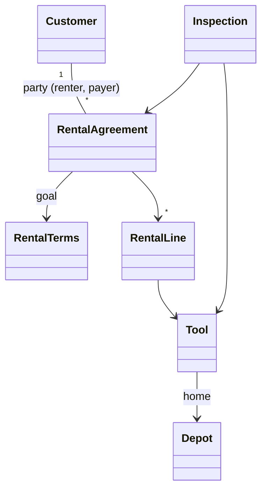

# Applying the Building Blocks End to End

Tactical design is a sequence of small, checkable decisions, each driven by a concrete use case: separate coordination from domain logic, classify every concept, constrain associations, draw aggregate boundaries, pick repositories only for roots the use cases need to find, walk scenarios through the design, and revise the model when the design gets awkward. This skill runs that sequence on an equipment-rental shop; reuse the steps, not the domain.

## 0. Starting model and requirements

Requirements: (1) book tools for a customer over a period, (2) record check-out and return inspections, (3) invoice when a rental is returned. First sketch, in the team's language:



Iterate the sketch with the domain expert before coding; the sketch below is the result of several passes, not the first draft.

## 1. Isolate the domain

Three application coordinators, each thin: **Booking** (create an agreement), **Counter** (log check-outs, returns and inspections), **Rental Status** (what is out, where, until when). They load objects, call the domain, commit and respond. They never decide whether a booking is allowed.

## 2. Entities and value objects, with identity sources

| Concept | Kind | Identity / reason |
|---|---|---|
| Customer | ENTITY | Existing customer number from the shop's CRM, so identity stays continuous across systems |
| Tool | ENTITY | Asset tag stuck on each physical tool; two identical drills must be told apart |
| RentalAgreement | ENTITY | Generated agreement number, shown to the customer |
| Inspection | ENTITY | Real-world events are not interchangeable; expert confirms tool + agreement + time + kind is unique |
| Depot | ENTITY | Internal generated ID; names are not unique |
| RentalTerms | VALUE | Period, pickup depot, deposit rule: describes a goal; two agreements may share equal terms |
| PartyRole | VALUE | `renter`, `payer`; qualifies the customer association |
| RentalPeriod, Money, Condition | VALUE | Only attributes matter |

Every identity decision that was not obvious came from asking the domain expert, not from the database.

## 3. Give associations a direction

- Customer does not hold its agreements: it is used by many parts of the business and repeat customers would drag long collections. Find agreements by customer through a repository query instead.
- Inspection points to Tool; Tool does not list its inspections, because the business tracks rentals, not a tool's full history (yet).
- RentalTerms (a value) does not point back to its agreement.
- Depot is referenced by many objects and tracks none of them.
- PartyRole qualifies Customer-Agreement: at most one customer per role per agreement.

## 4. Aggregate boundaries

- Customer, Tool, Depot: shared by many agreements, so each is its own root.
- RentalAgreement: root; lines and terms live inside (created and deleted with it, never looked up alone).
- Inspection: could sit inside the agreement, but counter staff record inspections all day while office staff edit agreements. Making Inspection its own root keeps that hot write path free of contention on the agreement.

```ts
class RentalAgreement {                         // AGGREGATE ROOT
  private terms: RentalTerms;
  private readonly lines: RentalLine[];
  private readonly parties = new Map<PartyRole, CustomerId>();

  extend(newPeriod: RentalPeriod): void {        // scenario: customer keeps the tools longer
    this.terms = this.terms.withPeriod(newPeriod); // replace the value, never mutate it
  }
}
```

## 5. Select repositories from the use cases

Only roots, and only those a use case must find without traversal:

```ts
interface CustomerRepository { byNumber(n: CustomerNumber): Promise<Customer | undefined>; byName(q: string): Promise<Customer[]>; }
interface ToolRepository     { byAssetTag(t: AssetTag): Promise<Tool | undefined>; availableAt(d: DepotId, p: RentalPeriod): Promise<Tool[]>; }
interface AgreementRepository{ byNumber(n: AgreementNumber): Promise<RentalAgreement | undefined>; forCustomer(c: CustomerId): Promise<RentalAgreement[]>; add(a: RentalAgreement): Promise<void>; save(a: RentalAgreement): Promise<void>; }
interface DepotRepository    { byCode(c: DepotCode): Promise<Depot | undefined>; }
```

No repository for `RentalLine` (inner) or `RentalTerms` (value). Add `InspectionRepository` only when a use case needs it (step 8).

## 6. Walk scenarios through the design

- **Extend a rental**: `RentalTerms` is a value, so build a new one and replace it on the root.
- **Repeat rental** ("same kit as last month"): copy the aggregate carefully, deciding per element. Lines and terms inside the boundary are copied (period reset); party roles are copied as references to the *same* Customer entities, never cloned customers; the new agreement gets a fresh number from the normal source; nothing outside the boundary changes.

```ts
class RentalAgreement {
  asTemplateFor(newNumber: AgreementNumber, period: RentalPeriod): RentalAgreement {
    const copy = new RentalAgreement(newNumber, this.terms.withPeriod(period), this.lines.map(l => l.copy()));
    this.parties.forEach((customer, role) => copy.assign(role, customer)); // same entities, by ID
    return copy;
  }
}
```

If a scenario cannot be expressed cleanly, change the model, not just the code.

## 7. Factories and primitive constructors

Every class still needs a primitive constructor that yields a valid object (for an entity, at least with identity intact). A factory sits on top when creation hides choices: an `InspectionFactory` picks `CheckOutInspection`, `ReturnInspection` or `DamageReport` subclasses and fills defaults, so the counter coordinator never names a concrete class. Agreement numbers come from a factory that asks the sequence.

## 8. Pause and iterate

Recording a return inspection originally appended to a collection inside the agreement, locking the agreement on the busiest path. Revised design: inspections are found by query (`InspectionRepository.forAgreement`, `latestFor(tool)`), so creating one modifies nothing inside the agreement aggregate. The derived "rental history" is computed on demand from the repository. Trade-off: if a screen lists full histories constantly, the in-aggregate collection might be faster; choose by measured access patterns. The model did not change, only the implementation inside one boundary, which is the payoff of clear aggregates.

Current note: in many teams this kind of cross-aggregate follow-up (a return inspection triggering the invoice) is expressed with a domain event such as `ToolReturned`, handled after commit; Event Storming workshops are a common way to discover these events and boundaries before step 2.

## 9. Modules by domain story

Wrong: `entities/`, `values/`, `services/` (grouped by pattern, high coupling, low cohesion). Right, the story the business tells (sales signs customers, operations rents and inspects, back office bills):

```
customers/   customer, contact, rentalPlan
rentals/     rentalAgreement, rentalTerms, tool, depot, inspection, availability
billing/     invoice, money, tariff
```

## 10. New feature through an anticorruption layer

Sales keeps "fleet allocation quotas" in a separate planning system and wants bookings checked against them. A naive design makes the Booking coordinator call both systems and compare strings: business rules in the application layer and foreign categories leaking into our model.

Better:
- Wrap the external system in an ANTICORRUPTION LAYER, but present it as a domain SERVICE named for our responsibility (`FleetAllocation`), not for the other system.
- Reabstract its keyword categories into a model concept of ours, a value `RentalSegment` (tool category, depot region, season).
- The service, not the coordinator and not the agreement, derives the segment and applies the rule, because it knows the segmentation rules, which may differ by purpose (allocation vs tax) and change with sales strategy.

```ts
interface FleetAllocation {                      // domain service; implemented by the ACL
  mayAccept(agreement: RentalAgreement): Promise<AllocationDecision>;
}
class PlanningSystemAllocation implements FleetAllocation {
  constructor(private api: PlanningApiClient, private agreements: AgreementRepository) {}
  async mayAccept(a: RentalAgreement): Promise<AllocationDecision> {
    const segment = RentalSegment.derive(a);                  // our concept
    const quota = await this.api.quotaFor(toPlanningKeywords(segment)); // translation stays here
    const booked = await this.agreements.countInSegment(segment);       // repository returns a count
    return booked < quota ? AllocationDecision.accept() : AllocationDecision.waitlist(segment);
  }
}
```

Changes in the planning system now ripple only as far as the adapter.

## Workflow

1. Write the requirements and a first sketch in the team's language; plan to iterate.
2. Name the application coordinators and keep them free of rules.
3. Classify each concept as entity or value; get identity sources from domain experts.
4. Give every association a direction or a qualifier; delete unused ones.
5. Draw aggregate boundaries; split out roots on high-contention write paths.
6. Add repositories only for roots that use cases must find.
7. Walk each scenario; fix the model where it is awkward.
8. Define constructors and factories; decide identity assignment.
9. Revisit implementation choices (collection vs query) against access patterns.
10. Organize modules by domain story; integrate external systems via an ACL behind a domain service with your own concepts.
11. Update `DomainModel.md` and the glossary; hand scenarios to BDD.

## Red flags

- Coordinators deciding acceptance, pricing or allocation rules.
- Entity/value decisions made by "does it have a table?".
- Customer or Tool holding collections of everything that ever referenced it.
- A repository per class; repositories for inner objects.
- Prototype copies that clone referenced entities or reuse the old identity.
- A busy operational action locking a large aggregate.
- Foreign system category strings passed through the domain.
- Packages grouped by pattern.

## Related

- `../../../actions/ddd.md` — the workflow this procedure serves.
- `../../../actions/bdd.md` — scenarios written in the resulting language.
- `../IsolatingTheDomain/isolatingTheDomain.md` — layers and thin application coordinators.
- `../ModelInSoftware/modelInSoftware.md` — entities, values, services, modules, associations.
- `../DomainObjectLifecycle/domainObjectLifecycle.md` — aggregates, factories, repositories.
- `../../DeeperInsight/AnalysisPatterns/analysisPatterns.md` — reusing patterns like segmentation concepts.
- `../../StrategicDesign/ModelIntegrity/modelIntegrity.md` — anticorruption layer and context maps.
- `../../../actions/dev.md`, `../../../actions/tdd.md` — implementing the design test-first.
- `../../../ProductDefinition/specs/spec-definition.md` — where requirements come from (when installed).
- `../../../CleanCode/Boundaries/boundaries.md` — wrapping third-party APIs (when installed).
