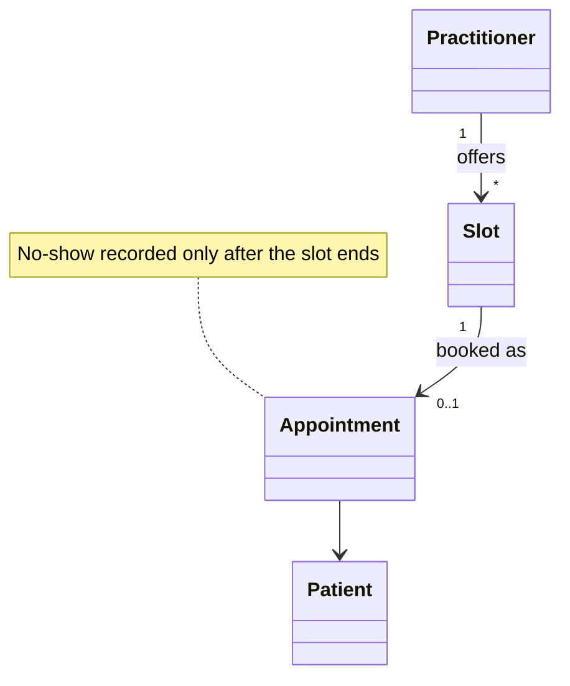

# Communication and the Use of Language

Use the domain model as the backbone of a single language, and commit the whole team to using it everywhere: conversation, tickets, specs, diagrams, tests and code. When a term feels awkward or ambiguous, experiment with alternative phrasings, settle on one, and then change the model and rename the code to match. A change in the language is a change in the model.

## The cost of a fractured language

- Experts speak their field's jargon (rich but often inconsistent); developers speak in design and technical terms the experts do not share. Neither dialect works for both groups.
- Translation is always lossy: it hides disagreements, lets team members use one word differently without noticing, and produces code that does not fit together.
- Bilingual individuals become bottlenecks and their translations are inexact.
- The sharpest phrasings of the domain often appear once, in a meeting, and never reach the code.

## UBIQUITOUS LANGUAGE

The language is made of:

- Names of classes, prominent operations, domain events and modules.
- The rules the model has made explicit ("a booking is confirmed only when a deposit is received").
- Names of patterns the team applies (AGGREGATE, REPOSITORY, SPECIFICATION, POLICY).
- Names of BOUNDED CONTEXTS and large-scale structure (they appear in the language even when not in code).

Rules of use:

- Developers use it among themselves to describe both code artifacts and tasks ("add a cancellation window to the Reservation", not "add a column and a cron job").
- Experts use it among themselves and with developers for requirements, planning and features. They may step outside it to give context, but within its scope they use it and object when it is awkward, incomplete or wrong.
- Persistent use exposes weaknesses. New words that appear in discussion are model changes and must flow into diagrams, glossary and code.
- Technical jargon (caching, retries) and deep business jargon beyond the application's scope are extensions to the language, never an alternative vocabulary for the same concepts.

Current note: a ubiquitous language holds within one BOUNDED CONTEXT. The same word ("Account", "Order") may legitimately mean different things in different contexts; the rule is one meaning per context, made explicit in the context map.

## Language in the code

The code is the most important place the language lives. Before:

```ts
class ApptMgr {
  async proc(rec: ApptRecord, flag: boolean) {
    if (flag && rec.st === 3) { rec.st = 5; await this.db.upd(rec); }
  }
}
```

After crunching with the clinic staff, who say "a no-show is recorded when the patient misses a checked-in slot... no, a *booked* slot":

```ts
export class Appointment {
  private status: AppointmentStatus = "booked";

  recordNoShow(at: Instant): void {
    if (this.status !== "booked") throw new DomainError(`Cannot record a no-show for a ${this.status} appointment`);
    if (at.isBefore(this.slot.end)) throw new DomainError("A no-show is recorded only after the slot has ended");
    this.status = "no-show";
  }
}
```

- Names come from the glossary, not from database columns or framework conventions.
- When the experts change a term, rename the class, method, test names, events and (eventually) schema and API fields. Prefer a deliberate rename refactor over leaving a stale name with a comment.
- Tests are part of the language: `it("records a no-show only after the slot has ended")` should read as a rule an expert would confirm.

## Modeling out loud

Try candidate phrasings aloud; rough edges are easy to hear. For a warehouse feature:

1. "We pass the order lines and the stock levels to the picker service and it, well, writes rows to the pick table."
2. "The order and inventory go into the allocation thing and we get back everything the pickers need."
3. "Allocation reserves stock for each order line and produces a Pick List for one picker's wave."

The third sentence uses model terms in relationships the model supports, so it is precise and testable. If the team cannot say a scenario fluently with model terms, the model is missing a concept or has a wrong one.

- Describe scenarios out loud step by step using model objects; find simpler ways to say them; take the simpler version back to the diagram and code.
- Fluency comes from use. Teams converge on shared meaning the way people inventing a pidgin do: by talking.

## One team, one language

- "Too abstract for the business" is not a reason for two languages. If capable experts cannot understand the core model, the model is likely wrong; and if they do not understand it, nobody can confirm the abstractions are sound.
- The model's terms are usually the experts' jargon, cleaned up with sharper and narrower definitions. Experts should learn those definitions and object when they drift from real usage.
- Experts can write use cases and acceptance criteria in the language. In this repo that means BDD scenarios use glossary terms verbatim.
- Multiple languages may be necessary (different BOUNDED CONTEXTS), but the split must never run between experts and developers.

## Keeping the glossary

Keep one glossary per bounded context, close to the code (for example a section of `DomainModel.md`). Each entry:

```markdown
| Term | Definition | Not to be confused with | Code |
|---|---|---|---|
| No-show | A booked appointment the patient did not attend, recorded after the slot ends | Late cancellation (patient cancelled inside the cancellation window) | `Appointment.recordNoShow` |
| Slot | A bookable time interval on one practitioner's schedule | Appointment (a slot that has been booked) | `Slot` value object |
```

- Record rejected synonyms so nobody reintroduces them ("we say Practitioner, not Doctor or Provider").
- Update the glossary in the same change that renames code; reviewers check that new names exist in it.

## Documents and diagrams

- Diagrams anchor conversation. Draw three to five objects central to the question, with names; redraw freely as the discussion moves.
- Avoid the all-encompassing class diagram: it shows attributes and associations and hides what matters most, the meaning of concepts and their behavior and rules.
- Prefer a text document illustrated with a few small diagrams over a diagram annotated with text. Casual, even hand-drawn, diagrams signal that the model is still evolving.
- The code holds the details. Documents should not repeat what code says well; they explain meaning, intent, large-scale structure and the core concepts, and help people navigate the code.
- A living document's terms show up in conversation and code. If the language moves on and a document does not, archive it; keeping it current by sheer discipline is wasted effort, and leaving it active misleads.
- A method name can lie where behavior cannot; keep names honest as behavior changes.



## Explanatory models

- One model should drive implementation, design and communication. But other views can teach the domain: a timeline of a patient visit, a floor plan of a warehouse, a flow of money.
- Explanatory models can cover context the strict model omits. Keep them visually distinct from design artifacts (avoid UML) so nobody assumes they map one-to-one onto code.

## Workflow

1. Before naming anything, look up the term in the context's glossary; if absent, ask an expert or note it as an open question.
2. During discovery, write down every term, synonym and conflicting usage; resolve each with an expert and record the chosen term, definition and rejected alternatives.
3. Say the key scenarios aloud using only model terms; where it is clumsy, propose alternative concepts and choose the one that reads naturally and is precise.
4. Apply the chosen names to classes, methods, events, modules, tests, scenario steps and API/DB fields where practical.
5. When a term changes, do a rename refactor across code, tests, scenarios and glossary in one change.
6. In review, flag names that are technical stand-ins (`Manager`, `Data`, `Info`, `Processor`, status codes) where a domain term exists.
7. Keep diagrams small and documents text-first; delete or archive documents the language has left behind.

## Red flags

- Developers and experts use different words for the same concept, or one word for two concepts, and nobody has noticed.
- Code names match database tables or a vendor API instead of the business vocabulary.
- A "business analyst" or lead who translates every conversation.
- Tickets and specs written in UI terms ("the button on screen 3") instead of domain concepts.
- New terms appear in meetings but the code keeps the old names.
- BDD scenarios or tests that use different words from the glossary.
- A huge generated UML diagram treated as the model; a design document no one reads but everyone is told to update.
- The same term reused across bounded contexts with different meanings and no explicit mapping.

## Related

- `../CrunchingKnowledge/crunchingKnowledge.md` — where the terms come from.
- `../ModelDrivenDesign/modelDrivenDesign.md` — why code names must mirror the model.
- `../../BuildingBlocks/ModelInSoftware/modelInSoftware.md` — naming entities, value objects and services.
- `../../DeeperInsight/SuppleDesign/suppleDesign.md` — intention-revealing interfaces.
- `../../StrategicDesign/ModelIntegrity/modelIntegrity.md` — bounded contexts and one language per context.
- `../../../actions/ddd.md` — owns the glossary and the domain model record.
- `../../../actions/bdd.md` — scenarios written in the ubiquitous language.
- `../../../actions/review.md` — checking names against the glossary.
- `../../../BDD/DefiningRequirements/ExecutableSpecifications/executableSpecifications.md` — declarative scenarios in business language (when installed).
- `../../../CleanCode/MeaningfulNames/namesThatRevealTheirPurpose.md` — intention-revealing names (when installed).
- `../../../CleanCode/MeaningfulNames/namingRules.md` — use problem-domain names (when installed).
