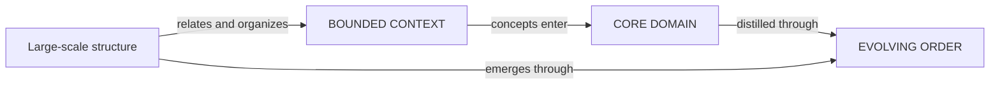
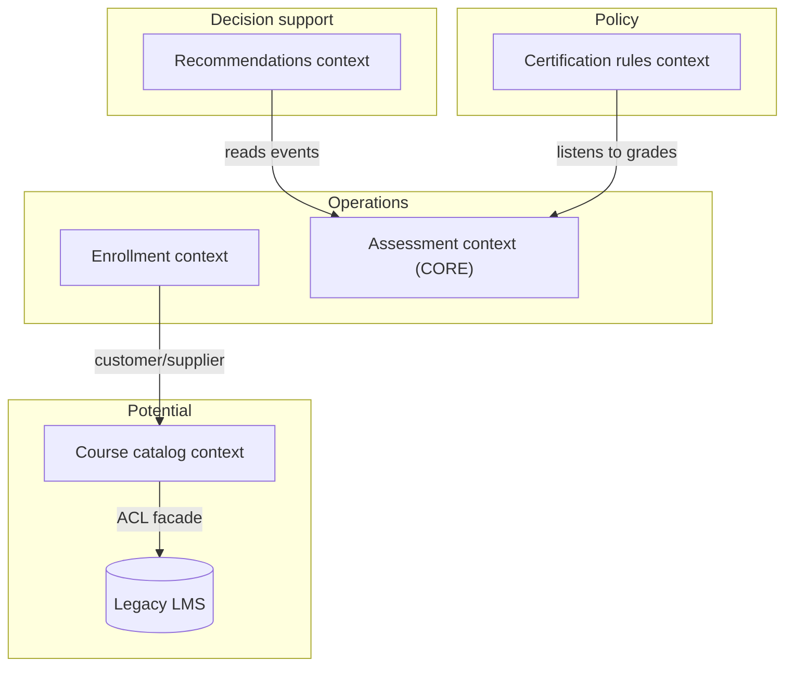

# Bringing the Strategy Together

Strategic design has three complementary tools: BOUNDED CONTEXTS (what must be consistent where), distillation (what matters most), and large-scale structure (how the parts relate). Start with an honest assessment of the current situation, decide together with the people who write the application code, keep every rule minimal and revisable, and let order grow piece by piece rather than from a master plan.

## How the three principles fit



- **Structure inside one context**: layer names apply only within that context, like any other model term. This raises how much complexity one unified context can hold.
- **Structure across the CONTEXT MAP**: the structure's terms apply project-wide and say what role each context plays. Often this is the bigger win, since the hard question is how separate parts fit.
- **Legacy and external systems**: you do not have to give up a structure because legacy does not follow it. State where the legacy actually sits (it may cover only one or two layers). Expose it through a FACADE or ANTICORRUPTION LAYER whose services each fit within one layer; a REPOSITORY interface can hide messy legacy queries.
- **Different structures per context** are possible (each context is its own namespace), but every extra one erodes the structure's value as a shared vocabulary.
- **Structure and distillation**: layers clarify how CORE modules and generic subdomains relate; and the structure itself can be CORE knowledge (for example, the business insight that commitments sit between policy and operations), which is valuable when CORE objects mean nothing in most contexts.

Example: an online learning platform, structure across the CONTEXT MAP.



The legacy LMS stays behind a catalog facade that only offers potential-layer services ("which courses and seats exist"), so nothing above has to understand it.

## Assessment first

Before choosing patterns, answer these and write the answers into the strategic section of `DomainModel.md`. Answers will be incomplete; refine them, especially the map and vision, as you learn.

```markdown
## Strategic assessment (date, author)
1. Context map: contexts found, relationships, ambiguous or overlapping areas.
2. Language: is there a ubiquitous language? Where does the code disagree with how experts talk?
3. Core domain: what is it? Is there a domain vision statement? Draft one if not.
4. Technology: does the stack support a model-driven design (rich domain objects, testable domain layer), or fight it?
5. Skills: can the team build the design this needs?
6. Domain knowledge: do developers know the domain, and want to?
Most urgent actions:
```

What the answers usually imply:

| Finding | First move |
|---|---|
| Cannot draw a consistent map | Name contexts, assign owners, add translation at messy boundaries (`../ModelIntegrity/modelIntegrity.md`) |
| No shared language | Glossary, rename code to match experts, model walkthroughs (`../../ModelInPractice/UbiquitousLanguage/ubiquitousLanguage.md`) |
| CORE unknown or neglected | Vision statement, highlighted core, staff it well (`../Distillation/distillation.md`) |
| Framework or ORM forbids behavior on domain objects | Isolate the domain, wrap the framework (`../../BuildingBlocks/IsolatingTheDomain/isolatingTheDomain.md`) |
| Nobody can see the whole | Consider a minimal large-scale structure (`../LargeScaleStructure/largeScaleStructure.md`) |

## Who sets the strategy

Architecture handed down before development by a separate, more powerful group rarely works. Two styles that do:

- **Emergent from application development**: a disciplined, communicative team arrives at shared principles through EVOLVING ORDER. Usually one hands-on developer acts as arbiter and communicator of the structure, not its sole author. Across a few closely aligned teams, representatives can meet to adopt, modify or shelve structure ideas discovered in one team.
- **Customer-focused architecture team**: a peer of the application teams that harmonizes structures, context boundaries and cross-team technical issues, discovers patterns with developers, and writes code with them.

Whatever the style, a strategic decision works only if it:

- **Reaches the whole team.** What matters is developers' actual relationship to the strategy, not the authority management grants it.
- **Absorbs feedback.** The depth needed comes from people building the application. Rotate architects through application teams or embed them.
- **Allows evolution.** Do not set the highest-level decisions in stone or take too much power from application developers.
- **Does not drain application teams of talent.** Strong designers are needed on every application team, and domain knowledge is needed on any strategy group.
- **Is minimal and humble.** Every rule gets in someone's way, so each must clearly earn its place. Enthusiastic architecture teams overbuild.
- Treats **developers as generalists**, even though objects are specialists: architects write application code, developers touch frameworks, everyone talks.

## Technical frameworks

Infrastructure frameworks speed up development and help isolate the domain, but can block expressive models and easy change even when they never meant to touch the domain. Apply the same biases: evolve them, keep them minimal, build them with application teams. Hiding irrelevant technical detail is good; prepackaging the domain because users "cannot design" is not. Test: does the framework respect the developers who will use it?

```ts
// Good: hides transport and retries, leaves the domain expressive
export interface EventPublisher { publish(events: DomainEvent[]): Promise<void>; }

// Bad: forces every domain object into a generic shape the framework understands
abstract class PlatformEntity { fields: Record<string, unknown> = {}; abstract validate(): string[]; }
```

## Piecemeal growth over master plans

City-planning experience applies: a master plan is too precise about the whole and not precise enough about connections, becomes obsolete, and removes the community's say. Prefer shared principles that every team applies to each small change, so coherent order grows and adapts. Encode the principles where possible (glossary, context map, import rules, review checklist) instead of a frozen blueprint.

Current note: microservice boundaries are commonly aligned with bounded contexts, and Event Storming is a common way to run the assessment collaboratively; neither changes the decision rules above.

## What marks a domain-driven project

No project uses every pattern. A domain-driven project is recognizable by:

- Understanding the domain and putting that understanding into the software as the top priority.
- Conscious care for the language, refined continuously.
- Dissatisfaction with the current model because the team keeps learning; an ill-fitting model treated as a risk, refinement as an opportunity.
- Design skill taken seriously, with strong designers on the application.
- Feedback from implementation back into the model kept alive; when performance or deadlines push code away from the model, change the model rather than silently breaking the link.
- Early, iterative releases, so model problems surface while they are cheap to fix.

Success is not longevity. A design that a later team transforms through new insight succeeded; an opaque system that survives as untouchable legacy did not. Tests and a short distillation document are what let a successor team keep the language alive. Tools help when they support thinking; automating what must be thought out is counterproductive.

## Workflow

1. Run the six-question assessment with developers and domain experts; record it in `DomainModel.md`.
2. Draw or update the CONTEXT MAP as it really is, including legacy and external systems.
3. Identify the CORE DOMAIN and write or refresh the vision statement.
4. Decide whether a large-scale structure is needed; if so, choose whether it applies within one context or across the map, and place legacy systems in it honestly.
5. Pick the first actions from the findings table; prefer the ones that touch the CORE.
6. Agree who arbitrates strategic decisions and how changes are proposed, reviewed and announced; keep architects hands-on.
7. Revisit the assessment at each milestone; prune any rule, layer or framework feature that no longer pays its way.

## Red flags

- A strategy document produced by a group that does not write application code, ignored by those who do.
- All the strongest designers moved to platform or architecture teams; application teams staffed with whoever remains.
- A strategy group without anyone who deeply knows the domain.
- An internal framework built to keep developers from making design decisions.
- Starting with a large-scale structure or framework before the context map and CORE are understood.
- Each context inventing its own structure, so there is no shared big picture.
- Legacy declared "outside the architecture" instead of placed in it behind a translator.
- Late first release; performance fixes that quietly disconnect code from the model.
- "We do DDD" meaning only the tactical patterns, with no language, map, or CORE.

## Related

- `../../../actions/ddd.md` — the workflow that writes the strategic assessment, map, CORE and structure into `DomainModel.md`.
- `../../../ProductDefinition/specs/spec-definition.md` — the spec the assessment builds on.
- `../../../actions/dev.md`, `../../../actions/review.md` — applying and checking strategic rules in daily work.
- `../ModelIntegrity/modelIntegrity.md` — BOUNDED CONTEXT, CONTEXT MAP, ANTICORRUPTION LAYER, relationship patterns.
- `../Distillation/distillation.md` — CORE DOMAIN, vision statement, distillation document.
- `../LargeScaleStructure/largeScaleStructure.md` — EVOLVING ORDER, RESPONSIBILITY LAYERS, KNOWLEDGE LEVEL.
- `../../ModelInPractice/ModelDrivenDesign/modelDrivenDesign.md` — keeping code bound to the model, hands-on modelers.
- `../../ModelInPractice/UbiquitousLanguage/ubiquitousLanguage.md` — the language the strategy must enter.
- `../../BuildingBlocks/IsolatingTheDomain/isolatingTheDomain.md` — frameworks and the domain layer.
- `../../../CleanCode/Systems/systems.md` — growing system architecture incrementally (when installed).
- `../../../DevOps/Practices/WhatIsDevOps/whatIsDevOps.md` — team collaboration and early, frequent releases (when installed).
