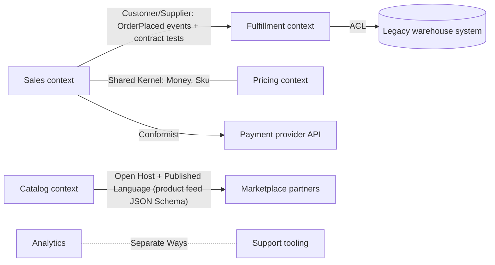

# Maintaining Model Integrity

A model is only useful while it is internally consistent: every term has one meaning and no rules contradict. Total unification across a large system is not feasible, so make the boundaries explicit: name each BOUNDED CONTEXT, keep its model unified with CONTINUOUS INTEGRATION, draw a CONTEXT MAP of how contexts touch, and pick a relationship pattern for every contact point based on control, team cooperation and how much integration you actually need.

## BOUNDED CONTEXT

A BOUNDED CONTEXT is the explicit scope inside which one model applies and is kept strictly consistent. Set its boundary in three dimensions: which team owns it, which part of the application uses it, and its physical artifacts (code base or modules, database schema, deployables). Inside, keep the model pure; outside, other models with other dialects of the UBIQUITOUS LANGUAGE apply, and crossing the line always involves translation.

- A MODULE or package is a mechanism for separating code, not a decision about models. Separate namespaces can even hide accidental divergence. Decide the context first; then let modules reflect it.
- A context is defined by intention to unify. A legacy system nobody integrates continuously only weakly qualifies; expect contradictions inside it.
- Record the context of the project as it is, not as it should be. Two teams "casually sharing" classes without a process are already in different contexts.

```ts
// Same word, two contexts, two models. Neither imports the other.
// sales/domain/Order.ts  (Sales context: a customer's commitment to buy)
export class Order {
  constructor(readonly id: OrderId, private lines: OrderLine[], private status: "draft" | "placed" | "cancelled") {}
  place(): OrderPlaced { /* pricing and credit rules */ }
}

// fulfillment/domain/Shipment.ts  (Fulfillment context: what leaves the warehouse)
export class Shipment {
  constructor(readonly id: ShipmentId, readonly salesOrderRef: string, private parcels: Parcel[]) {}
  pack(parcel: Parcel): void { /* weight and carrier rules */ }
}
```

Current note: microservice boundaries are often aligned with bounded contexts, but a context can be one module in a monolith, and one context can span several deployables. The context is a model boundary first, a deployment boundary second.

## Recognizing splinters

Unrecognized model differences show up as interfaces that do not fit, behavior that surprises, and above all confused language. Two kinds of splinter:

| Splinter | What it looks like | Typical damage |
|---|---|---|
| Duplicate concepts | `Client` in one package and `Customer` in another for the same thing, synced by conversion code | Two rule sets drift; every change must be made twice and rarely is |
| False cognates | One `Account` class used for a login identity and for a billing ledger | Teams overwrite each other's assumptions; rows that are valid for one meaning break reports for the other |

Typical false-cognate story: a second team "reuses" an existing class, renames their field to fit an existing attribute, adds the columns they need, and the original feature starts crashing on records that miss values its validation always guaranteed. When you find a splinter, decide consciously: pull the model back together and strengthen integration, or split it into two contexts with an explicit relationship.

## CONTINUOUS INTEGRATION

Inside one context, models fragment as soon as three or four people change them. People misread intent, duplicate concepts they did not find, or copy code because they fear breaking it. Integrate at two levels:

- Implementation: a reproducible merge and build, automated tests, and a short maximum lifetime for unmerged changes (at least daily for most teams).
- Concepts: constant use of the UBIQUITOUS LANGUAGE in conversation, reviews, tests and code names, so divergent meanings surface early.

Only the inside of a context needs this pace. Translation with neighbors can evolve more slowly. A context bigger than a two-person task without CI will splinter.

## CONTEXT MAP

A CONTEXT MAP names every model in play (including implicit models of non-OO subsystems, spreadsheets and vendor products), places all code in some context, and describes each point of contact: what is shared and where translation happens. Names of contexts enter the language: say "the Billing model changed, so the Sales-to-Billing translator must change", not "Priya's team changed their stuff".

- Map current reality first. If a relationship does not fit a named pattern, describe it as it is; mark a tangled, inconsistent area as such ("here be dragons") and keep mapping.
- Fix only outright contradictions until the map is complete; then plan changes. Update the map after reality changes, not before.
- Any form works (diagram, table, text) as long as everyone shares it and can tell which context any file belongs to (folder or package naming convention).



### Testing at the boundaries

Contact points deserve the strongest tests because translation is subtle and communication across teams is thin. Make translators pure functions and test them in isolation; add contract or acceptance tests that feed real inputs through the boundary service and assert the result in your model's terms. When you depend on a model you do not control, these tests are your early warning.

## Choosing a relationship

| Pattern | Use when | Cost / risk |
|---|---|---|
| SHARED KERNEL | Two cooperating teams need a closely overlapping subset (often generic pieces or part of the core) | Kernel changes need consultation; both test suites must pass; heavier deployment coordination |
| CUSTOMER/SUPPLIER | One-way dependency, upstream is motivated (shared management or a key customer) | Needs real planning negotiation and jointly owned acceptance tests in upstream CI |
| CONFORMIST | Upstream will not accommodate you, its model is usable, interface is large | You inherit its model and limits; only additive extensions |
| ANTICORRUPTION LAYER | You need integration but the other model is weak, foreign or would distort yours | Translation can become a sizeable subsystem; isolation is expensive |
| SEPARATE WAYS | Little real integration benefit | Later merging is hard; some duplication |
| OPEN HOST SERVICE | Many consumers need your subsystem | Designing a clean shared protocol is hard; consumers couple to its vocabulary |
| PUBLISHED LANGUAGE | Interchange needs a stable, documented shared model | Language must stay stable while your internal model keeps changing |

The patterns run from high control and communication (single context, shared kernel) to low (conformist, separate ways). The deciding factors are your control over the other model, how well the teams cooperate, and how deeply features and data must integrate. In practice, politics often decides.

## SHARED KERNEL

Designate an explicit subset of the model (plus its code and schema) that two teams agree to share. It has special status: nobody changes it without the other team. Integrate it less often than each team's own CI (for example weekly) and run both teams' tests at each kernel integration. Keep it small: typically value objects and a few generic concepts, not whole aggregates that each team wants to evolve.

```ts
// packages/shared-kernel/src/money.ts  — owned jointly; CODEOWNERS lists both teams
export class Money {
  private constructor(readonly amountMinor: bigint, readonly currency: "EUR" | "USD" | "BRL") {}
  static of(amountMinor: bigint, currency: Money["currency"]) { return new Money(amountMinor, currency); }
  add(other: Money): Money {
    if (other.currency !== this.currency) throw new Error("Currency mismatch");
    return new Money(this.amountMinor + other.amountMinor, this.currency);
  }
  equals(other: Money) { return this.currency === other.currency && this.amountMinor === other.amountMinor; }
}
```

## CUSTOMER/SUPPLIER DEVELOPMENT TEAMS

When one context feeds another and dependencies go one way, make the downstream team a real customer: it joins upstream planning, negotiates and budgets its requirements, and is available to answer questions. The non-negotiable part is automated acceptance tests for the interface the downstream expects, written jointly and run in the upstream's CI. Changing one of these tests is an interface change and requires a conversation. It works when both teams answer to someone who cares about the outcome; without that motivation, fall back to CONFORMIST, ACL or SEPARATE WAYS.

```ts
// Lives in the Sales repo, authored with Fulfillment. Breaks Sales' build, not Fulfillment's.
test("OrderPlaced carries what Fulfillment needs to create a shipment", () => {
  const event = placeOrderFixture().place();
  expect(event).toMatchObject({ orderId: expect.any(String), shipTo: { postalCode: expect.any(String) } });
  expect(event.lines.every(l => l.sku && l.quantity > 0)).toBe(true);
});
```

## CONFORMIST

When the upstream has no reason to serve you, stop waiting for promised features. If its design is reasonable and the interface is large, adopt its model wholesale where you touch it: no translation, shared vocabulary, much less complexity. Do it wholeheartedly, extending only by addition, never reinterpreting its concepts. This is often right for a large off-the-shelf component or a dominant platform you are extending (a plugin, a decision-support tool on top of an ERP). If the upstream is poorly designed or your app's core value depends on a different model, use an ACL instead.

## ANTICORRUPTION LAYER

An isolating layer that offers your context the other system's capabilities in your own model's terms, talking to the other system through its existing interface and translating in both directions. It is a conceptual translation mechanism, not a transport; where the network calls happen is a deployment detail.

Structure it from parts with one job each:

- SERVICES (occasionally an ENTITY) expressed in your model; one external system may become several services.
- A FACADE that simplifies the other system's messy interface but stays strictly in the other system's model (it belongs to their context).
- ADAPTERS that implement your service interfaces by making equivalent requests to the facade.
- Stateless translators that convert concepts and data; keep them separate from adapters so both stay simple and testable.

```ts
// fulfillment/domain/WarehouseAvailability.ts — port in our language
export interface WarehouseAvailability {
  reserve(sku: Sku, quantity: Quantity): Promise<Reservation>;
}

// fulfillment/infrastructure/legacyWms/LegacyWmsFacade.ts — their model, simpler surface
export class LegacyWmsFacade {
  constructor(private soap: WmsSoapClient) {}
  allocate(itemCode: string, qty: number, whse: string) {
    return this.soap.call("ALLOC_STK", { ITEM_CD: itemCode, QTY: qty, WHSE: whse, MODE: "H" });
  }
}

// fulfillment/infrastructure/legacyWms/WmsTranslator.ts — pure, unit-tested both ways
export const WmsTranslator = {
  toItemCode: (sku: Sku) => sku.value.replace(/-/g, "").toUpperCase(),
  toReservation(raw: { RC: string; ALLOC_ID?: string; QTY_OK?: number }, sku: Sku): Reservation {
    if (raw.RC === "04") return Reservation.rejected(sku, "out-of-stock");
    if (raw.RC !== "00" || !raw.ALLOC_ID) throw new WarehouseUnavailable(raw.RC);
    return Reservation.confirmed(sku, new ReservationId(raw.ALLOC_ID), Quantity.of(raw.QTY_OK ?? 0));
  },
};

// fulfillment/infrastructure/legacyWms/WmsAvailabilityAdapter.ts
export class WmsAvailabilityAdapter implements WarehouseAvailability {
  constructor(private wms: LegacyWmsFacade, private defaultWarehouse: string) {}
  async reserve(sku: Sku, quantity: Quantity) {
    const raw = await this.wms.allocate(WmsTranslator.toItemCode(sku), quantity.value, this.defaultWarehouse);
    return WmsTranslator.toReservation(raw, sku);
  }
}
```

- Never let raw codes (`RC`, `WHSE`) or foreign DTOs past the adapter. Translate at a meaningful level, not field by field: a low-level data feed throws away the meaning the other model gave the data.
- The layer may be bidirectional (inbound events from the other system get their own adapter).
- Relationship-specific features belong here: call auditing, tracing, retries for the external system.
- If translation grows enormous and most of your important model mirrors the other one, reconsider CONFORMIST. If isolation costs more than it protects, make measured concessions in your model.
- ACLs also make sense between two of your own contexts that went SEPARATE WAYS but still need some integration.

## SEPARATE WAYS

Integration is always expensive. If two sets of functionality do not call each other, do not share objects, and do not share data during operation, cut them loose: separate contexts with no shared logic and, ideally, no data transfer. They can still sit behind one menu, portal or navigation shell. Being in the same use case does not mean features must be integrated. Ruthless scoping like this can deliver small useful tools quickly while the integrated product stalls. The cost: if integration is needed later, translation will be harder.

## OPEN HOST SERVICE and PUBLISHED LANGUAGE

When many consumers integrate with you and bespoke translators pile up, define one protocol as a coherent set of SERVICES, open it to all, and extend it for common needs. Serve idiosyncratic needs with a one-off translator on top instead of bloating the protocol. Consumers couple to the host's vocabulary, so pair it with a PUBLISHED LANGUAGE: a documented, stable interchange model that independent parties can implement compatibly. Prefer an existing standard (an industry schema, a well-known API subset) over inventing one.

```ts
// catalog/api/v1/productFeed.schema.ts — the published contract, versioned separately from the domain
export const ProductFeedItemV1 = z.object({
  sku: z.string(), title: z.string(), priceMinor: z.number().int(), currency: z.enum(["EUR", "USD", "BRL"]),
  availability: z.enum(["in_stock", "backorder", "discontinued"]),
});
export const toFeedItemV1 = (p: Product): z.infer<typeof ProductFeedItemV1> => ({
  sku: p.sku.value, title: p.displayName(), priceMinor: Number(p.listPrice.amountMinor),
  currency: p.listPrice.currency, availability: p.availabilityForPartners(),
});
```

Do not make the interchange language equal to your internal model, or the model freezes. Keep them close to minimize translation, but keep the right to diverge.

Current note: today a published language is commonly an OpenAPI, AsyncAPI, JSON Schema, Protobuf or Avro contract, or a versioned integration event schema, with consumer-driven contract tests guarding it.

## Sizing contexts and choosing strategy

- Favor larger contexts when user tasks flow across the functionality, when one coherent model is easier than two plus mappings, when translation is hard, and when a shared language helps communication.
- Favor smaller contexts when communication overhead is high, CI is struggling, a unifying model would need rare abstraction skills, or user groups have precise jargons worth keeping.
- Start with external systems: they are outside your contexts. First ask whether SEPARATE WAYS suffices (could users simply access both?). If not, choose CONFORMIST for peripheral extensions with large interfaces, and a translation layer or ACL when your system does more than extend theirs, the interface is small, or their design is poor.
- For the system under design: one context is the default for a team under about ten working on interrelated features. Larger efforts split off fairly independent pieces, with SHARED KERNEL or CUSTOMER/SUPPLIER relationships; roughly one team per context.
- Separate contexts for special jargon cost shared language, integration effort and duplication, and can become an excuse for parochial models. A deep model may later unify the dialects; you cannot plan on it, only seize it.
- Let deployment feasibility shape boundaries: translation layers let one side release independently; a shared kernel couples releases; separate ways is simplest.

Current note: these choices are now often framed with core, supporting and generic subdomains, and boundaries are commonly discovered with Event Storming, looking for where language and ownership change.

## Transformations

Splitting contexts is easy; merging or changing relationships is hard and must happen in small steps.

- Separate ways to shared kernel: confirm both contexts are internally unified; set up the shared code location, naming and test suite first (at least weekly integration); start with a small, generic, already-translated subdomain; a 2-4 person group from both teams agrees the shared model and its tests; both teams integrate; delete the translations that became unnecessary; repeat with bigger pieces. Defer pieces tailored to different user jargons unless a deeper model supersedes both. Alternative: move full responsibility for a subdomain to the preferred context without sharing.
- Shared kernel to one context: align CI practices, rotate people between teams, distill each model, then merge the core quickly but in digestible pieces, raising integration frequency to continuous.
- Phasing out a legacy system: choose a testing strategy (possibly running old and new in parallel); each iteration move one slice of legacy functionality into a new context and extend the ACL for it; after it runs in production, remove ACL parts no longer needed and retire or ignore dead legacy modules. Prefer slices that shrink the ACL.
- Ad hoc protocol to open host with published language: adopt a standard if one exists; otherwise distill the host's model, base the interchange language on that core, publish it, build a translator per collaborator, switch over.

Current note: the incremental legacy replacement is widely known as the strangler fig pattern, typically with the ACL at the routing seam.

## Workflow

1. List the models actually in play: teams, code bases, schemas, external systems, spreadsheets. Note where the same word is used and test whether it means the same thing.
2. Name each BOUNDED CONTEXT and add the names to the glossary; assign every module, package and table to exactly one context.
3. Draw the CONTEXT MAP as it is today: each contact point, its direction (upstream/downstream), what is shared, and where translation happens. Mark muddled areas instead of guessing.
4. For each contact point, pick the pattern from the table using control, cooperation and integration need; for external systems ask SEPARATE WAYS first.
5. Record the decisions in `DomainModel.md` (context, owner, relationship, contract location) and keep context-specific glossary entries separate where terms differ.
6. In code, enforce boundaries: one top-level folder or package per context, no imports of another context's domain classes, translation only in designated adapters or translators. Add an import-lint or architecture test.
7. Put tests on every boundary: pure translator unit tests, contract or acceptance tests in the upstream's CI, schema checks for published languages.
8. Inside each context, keep CI fast and frequent and keep using the context's dialect in names, reviews and scenarios.
9. Change boundaries only in small, planned steps; update the map once the change is real. Moving data between contexts' schemas, retiring a legacy system, or switching consumers to a new published contract touches production: back up, run in parallel or behind a flag, and keep a rollback path.

## Red flags

- One `Customer`, `Order` or `Product` class serving every team, with optional fields and flags meaning different things to different callers.
- A "common" or "shared" library growing domain classes without an agreed owner, change process or joint tests.
- Foreign DTOs, status codes or column names appearing in your domain objects or use cases; translation logic scattered across controllers and services.
- Two services reading and writing the same tables, each with its own interpretation.
- Downstream plans built on upstream promises with no contract tests and no shared management.
- A conformist that reinterprets upstream concepts, or an ACL that is mostly a pass-through for a model you actually adopted.
- Field-by-field data synchronization used as "integration" between systems with different meanings.
- Integrating features that never call each other or share data, just because they appear in the same use case or screen.
- Public API or event schema that is a serialized internal aggregate, so every refactoring breaks consumers.
- Context map drawn as the ideal future instead of the present, or code with no clear context.
- Splitting a context into many tiny ones to escape complexity, losing integration that distillation or structure could have preserved.

## Related

- `../../../actions/ddd.md` — the workflow that records contexts, the context map and the glossary in `DomainModel.md`.
- `../../../actions/dev.md`, `../../../actions/tdd.md` — implementing adapters, translators and contract tests.
- `../../../actions/review.md` — checking boundary leaks and cross-context imports.
- `../../../actions/bdd.md` — scenarios written in one context's dialect.
- `../../ModelInPractice/UbiquitousLanguage/ubiquitousLanguage.md` — dialects of the language per context.
- `../../BuildingBlocks/IsolatingTheDomain/isolatingTheDomain.md` — where adapters and translators sit relative to the domain layer.
- `../../BuildingBlocks/ModelInSoftware/modelInSoftware.md` — MODULES and SERVICES used inside and at the edges of a context.
- `../../DeeperInsight/Breakthrough/breakthrough.md` — the deeper model that can unify clashing contexts.
- `../Distillation/distillation.md` — core domain, generic subdomains and the distilled core behind a published language.
- `../LargeScaleStructure/largeScaleStructure.md` — structure inside a large context before splitting it.
- `../BringingTheStrategyTogether/bringingTheStrategyTogether.md` — combining contexts, distillation and structure.
- `../../../CleanCode/Boundaries/boundaries.md` — wrapping third-party code (when installed).
- `../../../CleanCode/Systems/systems.md` — separating construction and cross-cutting concerns at system level (when installed).
- `../../../DataSystems/Foundations/EncodingAndEvolution/encodingAndEvolution.md` — evolving published schemas compatibly (when installed).
- `../../../DataSystems/DistributedData/Transactions/transactions.md` — consistency within a context vs across contexts (when installed).
- `../../../DevOps/Practices/ContinuousIntegration/continuousIntegration.md` — the implementation side of CONTINUOUS INTEGRATION (when installed).
