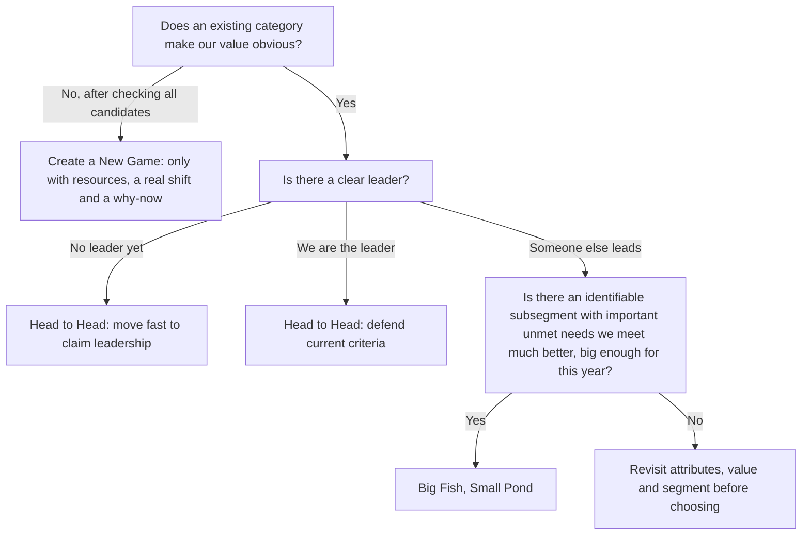

# Step 8. Find a Market Frame of Reference That Puts Your Strengths at the Center

Pick the market category that makes your unique value obvious to the customers who care most about it, then pick a style for winning there. A market must already exist in customers' minds (unless you deliberately take on the rare, expensive job of creating one), because the point of naming it is to trigger assumptions about competitors, features and price that work for you. The original "default" market, set aside in Step 3, is only one candidate.

## What the category does

- Naming a market answers the buyer's question "what are you?" and tells them what to compare you with, which features to expect, what you will cost and what benefits to look for.
- Products and markets both evolve, so the market you had in mind at conception (database, bicycle, robot) may no longer frame your strengths best. Your best customers may see markets differently from you.

## Finding candidate markets

1. **Abductive reasoning** ("if it looks like a duck..."). Take the key unique attributes and value themes and ask: what kinds of products typically have these features? Which category typically delivers this value?
2. **Adjacent markets, especially growing ones.** Market boundaries blur and shift, especially in tech. A drifted product may look more at home next door. Growing adjacent markets bring a rising tide of interest and buzz, but only choose one if it makes your strengths obvious; wanting to belong is not a reason.
3. **Ask customers, cautiously.** Existing customers try to place you in markets near where you already positioned yourself, and near their own industry or job function; they are not positioning experts and will often pick the most obvious frame, not the best. Prospects who have not yet struggled with your current frame may see differently. Dunford's database customer suggested "analytics" because he had been evaluating analytics tools; it was a useful clue, not an answer.

Dunford's Wattpad story illustrates a frame expanding over time: a mobile story platform recognized that its data on what readers love made it an entertainment company, then proved it with a TV adaptation before repositioning.

Test each candidate:

| Candidate market | Assumed competitors | Assumed table-stakes features (do we have them?) | Assumed price and model | Do our value themes look obvious here? | Exists in best customers' minds? |
|---|---|---|---|---|---|
| | | | | | |

## Three positioning styles

At a high level: enter an existing market (to win all of it, or a slice of it) or create a new one. Choose by competitive landscape and business goals.

| | Head to Head | Big Fish, Small Pond | Create a New Game |
|---|---|---|---|
| Goal | Lead an existing category | Dominate a subsegment of an existing category | Create a category and lead it |
| Purchase criteria | Accept the current ones | Keep them, add the subsegment's needs | Define new ones |
| Customer education | Little | Moderate: why general solutions fail this segment | Heavy: the problem, the category, then you |
| Fits | The current leader; or a category buyers understand with no clear leader yet | Challengers facing a strong leader; most startups | Rare; large companies or well-funded patient startups when no existing category fits |

### 1. Head to Head: win an existing market

- Buyers already know what the category is, what products in it do and the accepted buying criteria (a laptop is judged on screen, weight, memory, speed versus price). You claim to be best for most or all customers, playing the game as currently defined.
- **When to use**:
  - You are already the leader: the status quo and its criteria favor you.
  - A new or small company facing an entrenched leader: rarely. Trying to out-cola the cola leader is foolish.
  - A strong challenger: only when something (breakthrough capability, regulation, economics) is tilting the field.
  - The exception: a category buyers understand but where no strong leader exists yet. You get the category's assumptions without fighting a leader. Check with data that a critical mass of buyers already understands the category (tech teams are often years ahead of buyers), and expect competitors to arrive fast; you must grow quickly, which often means outside funding. Not a natural path for bootstrapped companies.
- **The work**:
  - As leader: keep reinforcing the current criteria and why you deliver them best; quickly counter rivals promoting new criteria.
  - As challenger: prove with hard evidence that you beat the leader at its own game.
- Good news: you can lean on what buyers already know. Bad news: you must fit their existing definition to win. A product missing a category basic but excellent at something narrower is a subsegment play, not a head-to-head winner.
- Dunford's database startup was unwittingly playing head to head with the database leader ("how are you better than Oracle?"). Repositioned into data warehousing, an understood category with no clear leader, it escaped that comparison and could raise prices.

### 2. Big Fish, Small Pond: win a subsegment

- Carve off a piece of an existing category where the rules differ just enough to give you an edge over the leader. Subsegment by industry, geography, size, preferences (gluten-free), ecosystem (Mac users, users of a specific marketing platform, low-bandwidth users) or other criteria.
- You keep the category's assumptions but avoid the stiffest competition (Dunford's image: cola for dogs, tasting of bones).
- **When to use** (all must hold):
  1. The category is well defined, with a clear leader that is not you. If the category is not understood, subsegmenting only adds confusion.
  2. There are definable groups with unique needs the leader does not meet.
  3. The subsegment is easily identifiable: you could build a list of prospects.
  4. You can show the need is specific *and* important. Dunford cites a pen marketed to women that was merely the regular pen in pink; it met no real need and was ridiculed off the market.
  5. You can meet that need much better than the leader, enough to overcome the "safe choice".
  6. It is big enough for near-term goals: if you need 30 deals and there are 100 prospects, look elsewhere; if there are thousands, it is big enough for now.
- **The work**:
  - Educate the subsegment that general-purpose solutions miss their needs; show the gap with proof and ideally quantify the value of switching.
  - Prove you are "good enough" on the category criteria that matter to them; you are not redefining the category.
  - Speak their language (their terms in pitches, their data in demos).
- Advantages: smaller segments are easier to list, reach and target; wins transfer directly from one customer to the next; tight communities spread word of mouth.
- Narrow is not forever: expand to adjacent segments where your success is relevant (credit unions, then retail banks, then insurance), and later perhaps go head to head or create a category.
- Risk: the leader turns toward your segment with a "good enough" offer or acquires a rival. Prefer advantages that are hard to copy, through IP or because copying would hurt the leader in its broader market (a cola for dogs would harm the human brand).
- Dunford's CRM startup went from being called a cheaper, worse version of the enterprise leader to "CRM for investment banks", where its relationship-modeling feature unlocked revenue. It raised prices, grew rapidly and was acquired by that leader.

### 3. Create a New Game: create a category

- Possible when new technology or circumstances open a new market, or when combining markets creates new buying criteria. Usually requires a big shift: technology, economics, regulation, attitudes; often an enabling technology, changing preferences and a supporting ecosystem converge.
- **When to use**: only after evaluating every existing category and concluding none puts your real differentiators and value at the center; or when you are large enough to command customer, media and analyst attention. If your product would need to stretch both the boundaries of a category *and* its purchase criteria, a new category likely makes more sense than stretching an old one in two directions.
- **The work** (the hardest style, a blank canvas):
  - Sell the problem before the solution: customers do not know they have the problem, its cost or the value of solving it.
  - Explain why the category must exist and why other categories fall short.
  - Teach how to evaluate solutions in it, and why you are the best vendor.
  - Have a product that is demonstrably, inarguably new; wishful thinking will not do.
  - Prepare strong arguments against incumbents calling you "just a feature" of their product.
  - Answer "why now?": what technology, behavior, regulation or economic shift makes this newly possible or necessary.
  - Commit money and time for a long, consistent effort; for startups this usually needs deep-pocketed, patient investors.
- **Reward**: a market shaped around your strengths, with purchase criteria matching what you do best; the creator is well placed to lead for a long time.
- **Main risk**: building the market and then losing leadership to a bigger competitor or fast follower just as buyers start to understand it. Defend leadership at every step.
- Dunford's Eloqua story shows a category emerging from serving an extreme early group ("demand generators") very well, waiting for that behavior to go mainstream, then broadening the label to "marketing automation" to separate itself from simple email tools. Its founder's lesson: real categories are discovered from narrow, extreme customers, not invented as an acronym at an offsite.

## Choosing the style

## Worked example

HVAC dispatch SaaS, value themes "win every emergency call" and "fix it the first time", segment: emergency-heavy residential contractors.

- Default frame "scheduling software": implies calendar tools as rivals, low per-seat price, and makes emergency routing look like an odd extra.
- Candidate "field service management (FSM)": understood by buyers, with clear leaders; the product lacks invoicing and inventory, so head to head fails.
- Chosen: Big Fish, Small Pond, "emergency dispatch for residential HVAC and plumbing contractors", a subsegment of FSM. The team must prove "good enough" on FSM basics that matter here (job records, mobile app, accounting integration), lead with emergency-call value, use contractor language and demo with emergency call data, and price on emergency jobs captured rather than per seat.
- Expansion path later: electricians and garage-door services with the same emergency pattern.

## Workflow

1. Start from the segment and value themes (Steps 6 and 7) and the alternatives (Step 4).
2. Generate candidate markets with abductive reasoning, adjacent and growing markets, and cautious customer input.
3. For each candidate, list the assumptions it triggers and check them against the product and the best customers' minds.
4. Discard markets that make key strengths look strange or that require features you lack.
5. Choose the style using the decision rules; confirm segment size against this year's deal count for a subsegment play.
6. Write the style's work plan: proof to gather, education needed, category criteria to meet, defensive risks.
7. Only consider category creation after documenting why every existing category fails and how the why-now, budget and leadership defense will be handled.

## Red flags

- Every prospect's first question is "how are you better than [category giant]?".
- A startup positioned head to head against an entrenched leader with no shifting ground.
- A new category name invented in a meeting with no evidence buyers lack an existing frame for the product.
- Category creation without a why-now, without funding for long-term education, or without a plan against "just a feature".
- A niche defined by a cosmetic difference rather than a real, important unmet need.
- A niche you cannot build a list for.
- A growing, trendy adjacent market chosen because it is hot, though it hides the product's strengths.
- Choosing a category solely because customers said so.
- Subsegment play that never proves "good enough" on category basics.

## Related

- `../WhoCaresALot/whoCaresALot.md` — Step 7, the segment the frame must speak to.
- `../ValueThemes/valueThemes.md` — Step 6, the value the frame must make obvious.
- `../PositioningBaggage/positioningBaggage.md` — Step 3, setting aside the default market.
- `../LayerOnATrend/layerOnATrend.md` — Step 9, adding why-now on top of the category.
- `../../WhatIsPositioning/FiveComponents/fiveComponents.md` — the market category component.
- `../../../MarketingManagement/MarketStrategy/ValuePropositionAndPositioning/valuePropositionAndPositioning.md` — Kotler, competitive frame of reference.
- `../../../MarketingManagement/ManagingGrowth/CompetitiveGrowth/competitiveGrowth.md` — Kotler, leader, challenger, follower and nicher strategies.
- `../../../MarketingManagement/ManagingGrowth/NewOfferings/newOfferings.md` — Kotler, launching new offerings and educating markets.
- `../../../GoodStrategyBadStrategy/SourcesOfPower/Dynamics/dynamics.md` — Rumelt, riding waves of change (the why-now).
- `../../../GoodStrategyBadStrategy/SourcesOfPower/Focus/focus.md` — Rumelt, focus as the source of a niche advantage.
