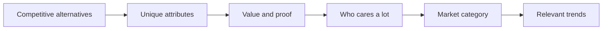

# The Five (Plus One) Components of Effective Positioning

Do not "do positioning" by filling in a positioning statement; that only writes down current assumptions. Instead, decompose positioning into five components plus an optional sixth, define each with evidence, and define them in dependency order: competitive alternatives first, then unique attributes, value, target customers, market category, and finally any relevant trend.

## Why not a positioning statement

The classic template (popularized in business schools and by *Crossing the Chasm*) reads roughly: For [target], [product] is a [category] that provides [benefit]; unlike [competitor], it [difference]. Dunford's own attempt at IBM produced a circular sentence that said nothing. As a method it fails because it:

- **Assumes you already know the answers.** It records today's beliefs and gives no signal whether they are good. It would never suggest that a "diet muffin" might be a "paleo snack".
- **Reinforces the status quo.** It invites the default frame, which usually favors the current market leader.
- **Gives no next step.** Teams that write one rarely use it: marketing does not consult it for messaging, product not for roadmap, sales not for targeting.
- **Is hard to remember** or repeat, so it fails even as documentation.

What it gets right: its blanks hint at the components. Use the components, not the sentence. Capture the result in a canvas instead (see [capture positioning](../../PositioningProcess/CapturePositioning/capturePositioning.md)).

## The components

| # | Component | Definition | Key question |
|---|---|---|---|
| 1 | Competitive alternatives | What customers would use or do if your product did not exist | "If we vanished, what would our best customers do?" |
| 2 | Unique attributes | Features and capabilities you have that the alternatives lack | "What can we do that they cannot?" |
| 3 | Value (and proof) | The benefit those attributes enable for customers, provable | "So what? How do we prove it?" |
| 4 | Target market characteristics | Traits of buyers who care a lot about that value | "Who cares most, and how do we spot them?" |
| 5 | Market category | The market you say you are in, to make your value obvious | "What frame makes our value obvious?" |
| +1 | Relevant trends (optional) | A trend your targets care about that makes you matter now | "Why should they care right now?" |

### 1. Competitive alternatives

- Not just named competitors. Often "hire an intern", "use a spreadsheet", "do it by hand" or "live with the problem".
- Customers know far less about the solution landscape than you do; they have usually never bought anything like your product and have never heard of the startup you worry about.
- In business software the most common alternative is general office tools plus manual process.
- The alternative is the yardstick for "better". If the real alternative is Excel, "easier to use" must mean easier than Excel, not easier than a rival startup.

### 2. Unique attributes

- Your "secret sauce": what you have that the alternatives do not.
- Not only technical features. Also delivery model (on-premise vs SaaS), business model (renting instead of selling), proprietary process, partnerships, distribution, or specific expertise (for example, a dozen international banks as clients).
- For service firms (agencies, consultancies, dev shops) it is usually a combination of expertise and experience: the only UX agency with enterprise training design experience, the only Python shop that knows retail point-of-sale.
- "Differentiators" only count when they differ from the *real* alternatives as the customer sees them.

### 3. Value (and proof)

- Value is why anyone should care about the secret sauce: the benefit the attribute enables, tied to a customer goal (answers in minutes instead of hours, so customers get served faster).
- Make it as fact-based as possible. Subjective claims ("people enjoy good design") are not believed.
- Your opinion is not proof. Customer statements, reviewer and analyst opinions, and data are hard to refute.

### 4. Target market characteristics

- The value is relevant to many, but limited budgets force focus on those most likely to buy: customers who buy quickly, rarely ask for discounts and refer others.
- Industry, location and size are rarely enough. Find the characteristic that makes them care: any small business can invoice, but those sending many invoices a month love an invoicing tool.
- Thought experiment Dunford uses: if you had to close a lot of business by month end or the company dies, which customers would you call, and why them?
- Specificity pays: "companies with lots of data" was too broad (many only archive it); "banks that must analyze huge data fast to spot security threats" was targetable.

### 5. Market category

- A frame of reference customers use to group similar products. Naming a category triggers assumptions about who your competitors are, which features you have and what you cost (call yourself a CRM and buyers assume Salesforce as the rival, contact/opportunity tracking as features, per-user monthly pricing).
- A good category does work for you: you need not list competitors or table-stakes features.
- A bad one works against you: you spend sales time fighting assumptions. Dunford's example is "email for lawyers" with no calendar whose real value was secure, context-aware file sharing; as team collaboration software, the missing calendar stopped mattering and the key feature made sense.
- Categories let customers use what they know to understand what they do not.

### +1. Relevant trends (bonus)

- A category is a set of similar products; a trend is a characteristic that is new and noteworthy at a given moment and can apply across many categories (AI, blockchain, AR in their day).
- Category answers "what is it and why care"; trend answers "why now", and can tie a purchase to company priorities, making it strategic and urgent.
- A trend alone is not a category: "AI" says nothing about what you are; "AI-powered CRM" says what you are (CRM) and why it is special now (AI). A pink couch is still in the couch business.
- Use only when the link is real. See [layer on a trend](../../PositioningProcess/LayerOnATrend/layerOnATrend.md). Dunford's Sampler story shows "direct-to-consumer sampling" tying a sampling service to brands' top initiative and speeding deals.

## How the components depend on each other

- Attributes are only unique relative to alternatives.
- Attributes drive value; value determines the best target customers; the customers and value point to the frame that highlights that value.
- Trends must be relevant to the target customers and combine with the category.
- Order matters. Starting from features (without alternatives) produces positioning disconnected from how customers evaluate; starting from value or a segmentation produces positioning that does not click.

## Template: component audit

Use to review an existing positioning before running the full process.

| Component | Current answer | Evidence (customer words, data, third party) | Gap or doubt |
|---|---|---|---|
| Competitive alternatives | | | |
| Unique attributes | | | |
| Value | | | |
| Who cares a lot | | | |
| Market category | | | |
| Trend (optional) | | | |

A component with no evidence column filled is an assumption, not positioning.

## Worked example

A consumer brand sells a shelf-stable oat-milk concentrate.

- Alternatives (best customers): carton oat milk from the supermarket; making oat milk at home.
- Unique attributes: one bottle makes 8 litres; no refrigeration until mixed; barista-grade foam formulation.
- Value: one-eighth of the shipping weight and fridge space; no more half-used cartons going sour; café-style foam at home (blind tests vs leading carton brand as proof).
- Who cares a lot: small-apartment, daily latte drinkers who buy plant milk weekly and own a milk frother.
- Category: plant milk (a concentrate sub-type), not "baking ingredient" or "supplement".
- Trend: low-waste packaging, only because the weight and carton reduction are real.

## Workflow

1. If the user asks for a positioning statement, explain briefly why you will produce components and a canvas instead (or both, with the statement derived from the components).
2. Gather inputs per component from customer interviews, win/loss notes, reviews and sales calls, not from the team's beliefs alone.
3. Define the components strictly in order, revisiting earlier ones when later ones expose a problem.
4. For each attribute, require a comparison to a named alternative; for each value claim, require proof.
5. Check the category's implied assumptions (rivals, features, price) against reality.
6. Add a trend only if it links to the product, the category and the target customers.
7. Hand off to the 10-step process for a full exercise, starting with [best customers](../../PositioningProcess/BestCustomers/bestCustomers.md).

## Red flags

- A positioning statement written in an afternoon with no customer evidence.
- Differentiators listed without saying what they are different *from*.
- The competitor list contains only startups customers have never heard of; spreadsheets and "do nothing" are missing.
- Value stated as adjectives ("powerful", "intuitive", "best-in-class") with no proof.
- Target market defined only by firmographics or demographics.
- A trend or a famous company used as the category ("the sharing economy for X", "Uber for Y").
- The category label implies features the product lacks or a price it cannot hold.
- Components defined starting from features or a segmentation instead of from alternatives.

## Related

- `../PositioningAsContext/positioningAsContext.md` — why positioning is context and how default positioning traps teams.
- `../../PositioningProcess/CompetitiveAlternatives/competitiveAlternatives.md` — Step 4, component 1 in depth.
- `../../PositioningProcess/UniqueAttributes/uniqueAttributes.md` — Step 5, component 2.
- `../../PositioningProcess/ValueThemes/valueThemes.md` — Step 6, component 3.
- `../../PositioningProcess/WhoCaresALot/whoCaresALot.md` — Step 7, component 4.
- `../../PositioningProcess/MarketFrameOfReference/marketFrameOfReference.md` — Step 8, component 5 and positioning styles.
- `../../PositioningProcess/LayerOnATrend/layerOnATrend.md` — Step 9, the bonus component.
- `../../PositioningProcess/CapturePositioning/capturePositioning.md` — Step 10, the canvas that replaces the statement.
- `../../../MarketingManagement/MarketStrategy/ValuePropositionAndPositioning/valuePropositionAndPositioning.md` — Kotler, value proposition, frame of reference, points of parity and difference.
