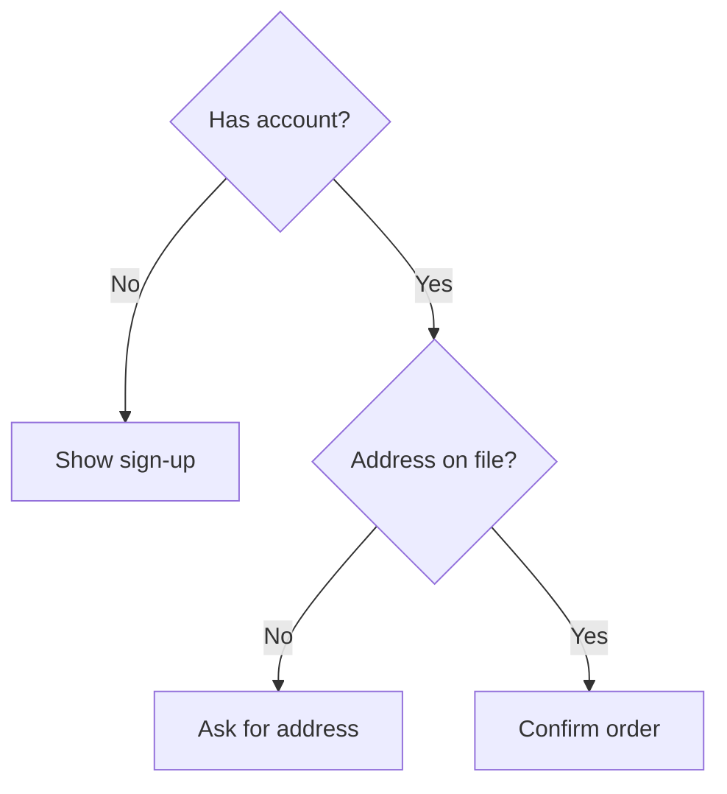

# Design Thinking

Design thinking is a loop: understand the people affected, state their problem in their terms, generate several solutions, make the cheapest artifact that can be tested, and test it with real users before committing code. In this repository the loop serves an approved spec: its artifacts (personas, journeys, decision trees) must trace back to research or to the spec, and any insight that would change product scope goes back to product as an open question rather than being decided in the UI.

## The five stages and what each must produce

| Stage | Purpose | Output that dev/tdd can use |
|---|---|---|
| Empathize | Learn needs, context and pain points from real users | Research notes with sources; pain points linked to spec requirements |
| Define | Restate the problem around the user's need | Problem statement and success criteria matching the spec's acceptance criteria |
| Ideate | Generate many options before choosing | Two or more candidate approaches with trade-offs and the chosen one |
| Prototype | Make the idea tangible at the lowest fidelity that answers the question | Sketch, wireframe or clickable prototype; the question it answers |
| Test | Check the prototype with users; refine or discard | Findings, changes made, residual risks; acceptance scenarios updated |

- The loop is not linear. A test finding can send you back to Define. If the new definition changes what the product promises, stop and raise it with product.
- Problem statement template: "[User from spec] needs a way to [goal] because [insight from research], measured by [criterion]." A "how might we" question reframes it for ideation.
- Keep fidelity proportional: paper or wireframe to test structure and flow, high fidelity only to test visual or interaction details.

## Personas

- A persona summarizes a cluster of real users who share goals, behaviors and pain points. It is valid only if it cites the research it came from.
- Useful content: goals, tasks, context of use, frustrations, expertise, accessibility needs, devices. Demographics and stock photos add little and invite stereotyping; omit them unless they change a design decision.
- Map each persona to the actors in the spec. A persona with no matching actor, or an actor with no persona, is an open question.
- Include people with disabilities in the research base, or define accessibility needs explicitly; do not leave them to edge-case lists.

```json
{
  "persona": "Shift supervisor",
  "source": ["interviews 2024-03 (n=7)", "support tickets tag:scheduling"],
  "goals": ["fill an open shift in under 5 minutes"],
  "context": "phone, on the floor, interrupted often",
  "painPoints": ["cannot see who is qualified", "calls people one by one"],
  "accessibility": ["one-handed use", "glare outdoors"],
  "specActors": ["Supervisor"]
}
```

## Journey maps

- A journey follows one persona through one goal, from trigger to outcome, across every touchpoint (app, email, support, physical).
- For each step record: what the user does, thinks and feels, the touchpoint, pain points and opportunities.
- Use journeys to find where the feature starts and ends, which states the system must show, and which steps belong to other teams (CX handoffs).
- Each journey step that the feature owns becomes at least one acceptance scenario.

```gherkin
Feature: Fill an open shift
  Scenario: Supervisor offers a shift to qualified staff
    Given an open shift requiring forklift certification
    When the supervisor opens the shift
    Then only certified, available staff are listed
    And the supervisor can offer the shift to all of them in one action
```

## Research inputs: focus groups, VoC and SMEs

| Method | Good for | Watch out for |
|---|---|---|
| Focus group (about 6 to 10 people, moderated) | Attitudes, vocabulary, reactions to a concept | Groupthink, dominant voices, moderator bias; reports opinions, not behavior |
| Interviews and observation | Real behavior and context | Small samples; needs synthesis |
| Voice of the Customer (surveys, support logs, reviews, social, sales calls) | Recurring pain points at scale | Loud minorities; self-selection; feedback is a symptom, not a solution |
| Subject matter expert | Domain rules, regulations, edge cases | Experts are not typical users; their workflow may differ from novices' |

- Use focus groups to explore language and attitudes; validate behavior with usability tests or analytics.
- Close the VoC loop: tag feedback, link it to the requirement or decision it affects, and tell customers what changed.
- SMEs supply rules that become validation and business logic; record each rule with its source so tdd can test it.
- All research with people needs informed consent, minimal personal data, and storage that matches the privacy policy.

## Collaborative techniques: charrettes and mind maps

- A design charrette is a short, intensive workshop with designers, stakeholders and SMEs: define the problem, prepare, ideate, develop concepts, critique, merge into one plan, present the rationale. Use it when many parties must agree quickly; time-box it and record decisions and open questions.
- A mind map starts from a central topic and branches into subtopics. Use it to explore a problem space or brainstorm; convert the useful branches into a structured list before handing off.

## Decision trees as UI logic

- A decision tree lists the questions and outcomes when the right path depends on several conditions. In UI terms it defines wizard steps, conditional form fields, eligibility checks and routing.
- Every leaf is an outcome the UI must show, so every leaf becomes a test case. Unreachable leaves and leaves with no defined outcome are spec gaps.
- Classification and regression trees from machine learning are a different tool; if the product uses one to decide something for the user, see the AI skill.



## Gamification, ethically

- Game elements (points, badges, levels, progress bars, streaks, leaderboards, challenges) can motivate when they reward behavior the user already wants: learning, finishing a task, building a healthy habit.
- Start from the target behavior and the user's goal, then pick the mechanic; launch, measure, and adjust.
- Refuse mechanics that work against the user: streaks that punish breaks to drive compulsive use, variable rewards tied to spending, leaderboards that shame, fake scarcity or countdowns. These are dark patterns and are never an acceptable decision.
- Provide opt-out for public leaderboards and social comparison; make rewards and their rules transparent; check that game elements do not distract from the real task or block accessibility (motion, color-only progress).

## Decisions to hand off

| Decide | Dev implements | TDD / acceptance verifies |
|---|---|---|
| Problem statement and success criteria (aligned with spec acceptance criteria) | Scope limited to the defined problem | Acceptance tests trace to each criterion |
| Personas mapped to spec actors, including accessibility needs | Roles, permissions, device and input support per persona | Scenarios written per persona; a11y needs covered by tests |
| Journey steps the feature owns, with entry and exit points | Routes, states and transitions for each owned step | One acceptance scenario per owned step; handoffs to other channels checked |
| Chosen solution among the ideated options, with rejected options and why | The chosen approach only | Prototype test findings recorded; scenarios reflect the chosen flow |
| Domain rules from SMEs, each with its source | Validation and business logic | Unit tests per rule citing the source |
| Decision-tree branches and outcomes | Conditional steps, fields and messages | One test per leaf; no undefined leaf |
| Gamification mechanics (if any), rules, opt-outs | Mechanic, transparent rules, opt-out setting | Tests for reward rules, opt-out, no penalty for breaks; ethics review noted |
| Feedback loop for VoC after release | Feedback entry point and tagging | Test that feedback is captured and linked |
| Insights that change scope | Nothing until product decides | Logged as open questions for product |

## Workflow

1. Read the approved spec; list its actors, goals and acceptance criteria. Gather existing research, VoC and SME input.
2. Empathize: fill gaps with interviews, observation or VoC review, with consent. Note sources.
3. Define: write the problem statement and success criteria; confirm they match the spec, or raise the difference with product.
4. Build or check personas and journeys against the research and the spec actors.
5. Ideate at least two approaches; choose one with explicit trade-offs.
6. Prototype at the lowest fidelity that answers the open question; test with representative users.
7. Turn decision trees, journey steps and SME rules into acceptance scenarios and test cases.
8. Fill the decisions table and hand it to dev and tdd; plan the post-release feedback loop.

## Red flags

- Personas or journeys with no research source, written from the team's assumptions.
- Focus-group opinions treated as proof of how people will behave.
- Jumping to high-fidelity screens before the problem is defined.
- Only one idea considered, or the first idea defended against test results.
- Test findings that change product scope silently implemented in the UI.
- Decision trees with leaves that have no defined outcome, or outcomes no test covers.
- Gamification that rewards spending, punishes breaks, shames users or cannot be turned off.
- Research or feedback collected without consent or retained beyond need.

## Related

- `../../actions/uiux.md` — the workflow that consumes this skill and records the decisions.
- `../UiUxFoundations/uiUxFoundations.md` — UCD, usability and accessibility criteria the loop is judged against.
- `../TaskAnalysis/taskAnalysis.md` — decomposing the tasks found in empathize and journeys.
- `../Ideation/ideation.md` — deeper techniques for the ideate stage.
- `../ModelingDiagrams/modelingDiagrams.md` — journey, flow and decision diagrams.
- `../Testing/testing.md` — usability tests for the prototype and test stages.
- `../Affordance/affordance.md` — dark patterns to refuse, including in gamification.
- `../ArtificialIntelligence/artificialIntelligence.md` — when a model, not a fixed tree, makes decisions for users.
- `../../ProductDefinition/plan.md` — product vision and goals the problem statement must serve (when installed).
- `../../ProductDefinition/specs/spec-definition.md` — actors and acceptance criteria personas and journeys map to (when installed).
