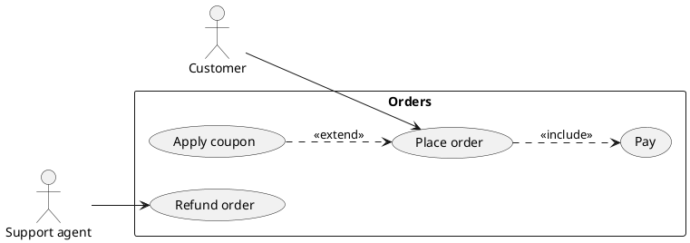
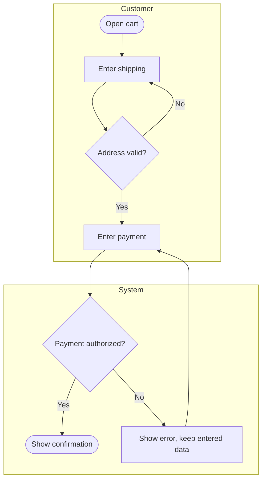
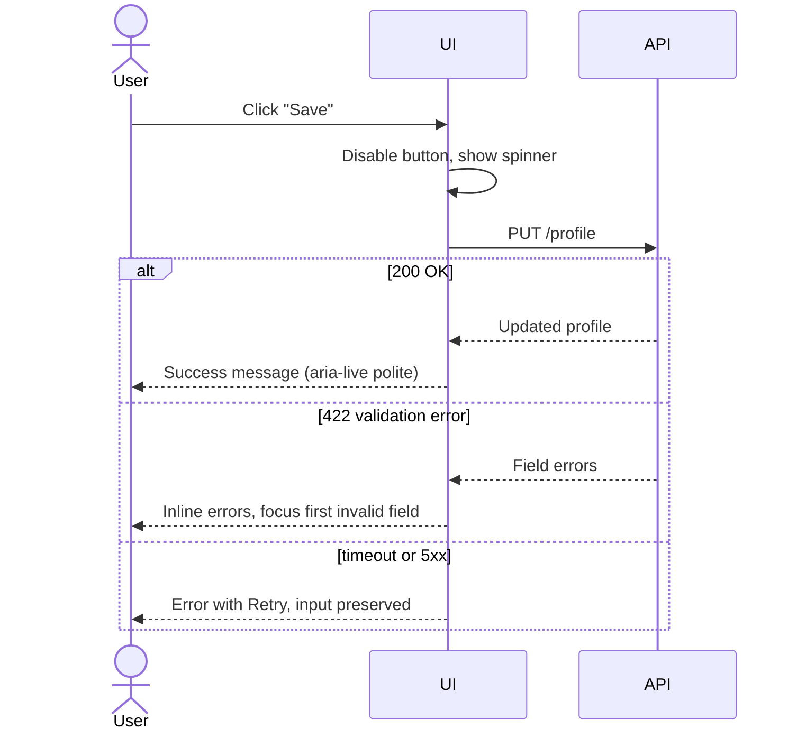
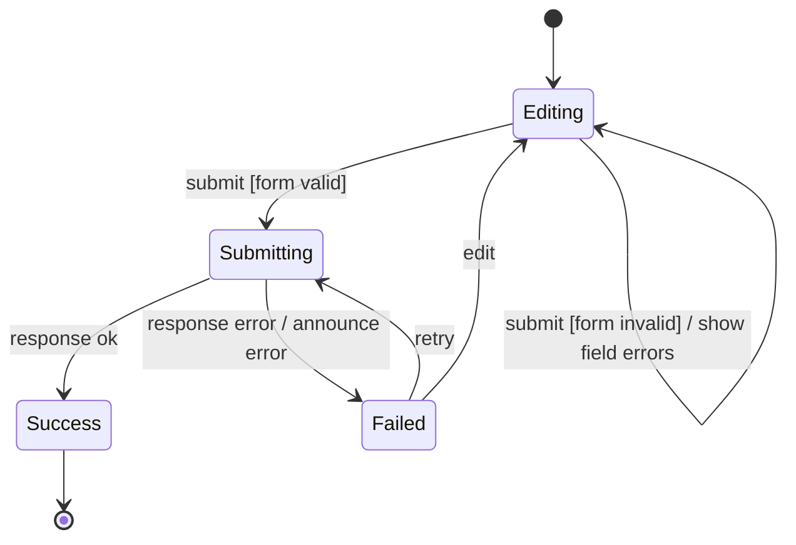
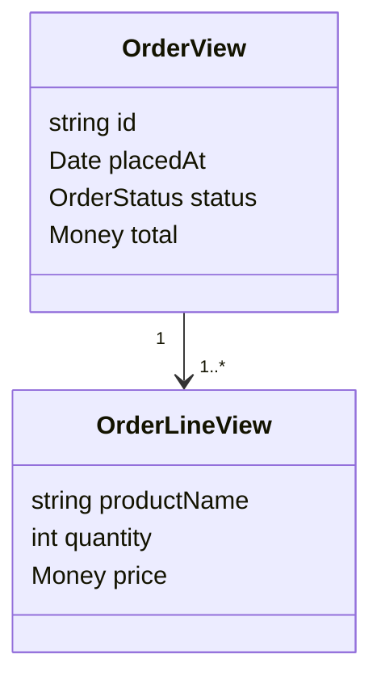
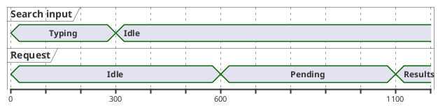

# Modeling diagrams

Draw a diagram only to answer a specific question about the UI that prose leaves ambiguous, pick the diagram type that answers it, and keep it as text (Mermaid or PlantUML) next to the spec. A good UI/UX diagram is directly testable: every state, transition, branch or message becomes code dev writes and a test tdd writes.

## Pick the diagram by the question

| Question | Diagram | UI/UX use |
|---|---|---|
| Who uses the system for what? | Use case | Scope of a feature per role; permissions |
| What steps and branches does a user go through? | Activity (flowchart), with swimlanes | User flows, wizards, approval processes |
| What does the UI exchange with the backend, in what order? | Sequence | Loading, optimistic updates, retries, error paths |
| Which states can a screen or component be in? | State machine | Idle/loading/empty/error/success, form validation, disabled rules |
| What data does a screen show and how is it related? | Class / ER | View models, entities displayed, cardinalities in lists |
| What timing constraints apply? | Timing | Debounce, autosave, toast duration, session timeout |
| Why do users fail here? | Cause-and-effect (fishbone) | Root-cause analysis of a usability defect |
| How is the frontend split and deployed? | Component, package, deployment | Micro-frontends, design-system package, CDN/edge |

Object diagrams (concrete instances) are useful as example data for tests; package diagrams show module dependencies.

## Use case diagrams

- Actors are roles or external systems, not people's names. Use cases are user goals ("Export report"), not screens or buttons.
- Association: actor participates in the use case.
- Include: the base use case always uses the included one (arrow from base to included, `<<include>>`).
- Extend: optional behavior inserted into a base use case under a condition (arrow from the extending use case to the base, `<<extend>>`).
- Each actor-to-use-case line is a permission decision: if the spec does not say which role may do it, ask product.



## Activity diagrams (flows)

Rounded actions, labeled arrows, diamonds for decisions, swimlanes for who acts. Every decision needs all outcomes drawn, and every path must end.



## Sequence diagrams (UI and backend)

Lifelines for the user, UI, API and services; solid arrows for synchronous calls, dashed for replies; `alt`, `opt`, `loop` fragments for branches. Always draw the failure and slow paths, since they drive loading and error UI.



## State machines (the most useful UI diagram)

States, events on transitions, guards in brackets, actions after a slash. Model every screen or component whose behavior depends on async work or user input. Impossible combinations (loading and error at once) disappear when the UI is driven by one state value.



```tsx
type FormState =
  | { status: "editing"; errors: Record<string, string> }
  | { status: "submitting" }
  | { status: "success"; id: string }
  | { status: "failed"; message: string };
```

tdd writes one test per transition (including the guarded self-loop) and one per state's rendering; dev implements with a reducer, discriminated union or a statechart library. Check also: what happens on double submit, navigation away mid-request, and session expiry.

## Class and ER diagrams for screens

Use them to agree on what a screen shows: entities, required vs optional fields, and cardinality (one order has many lines, so the UI needs a list with an empty state). Keep the persistence schema in the data or DBA skills; here model the view.



## Timing diagrams

Time on the horizontal axis, one lane per signal or state. Use them when the spec has durations: debounce delays, minimum spinner time to avoid flicker, autosave intervals, toast duration, session timeout warnings. Messages that disappear on a timer must give users enough time or a way to extend it (WCAG 2.2.1 Timing Adjustable).



## Cause-and-effect for UX problems

Put the observed problem at the head ("40% abandon at payment step") and brainstorm causes under adapted 6 M categories: people (user skills, expectations), methods (flow, steps), machines (devices, browsers, assistive tech), materials (content, copy, data quality), measurements (analytics accuracy, how the drop was measured), environment (network, context of use). Then verify the top causes with data or tests before fixing; the diagram lists hypotheses, not findings.

## Diagrams as code

| | Mermaid.js | PlantUML |
|---|---|---|
| Runs | In the browser; rendered natively by many Markdown hosts | Java/server or CLI; outputs PNG, SVG, PDF |
| Strengths | Flowchart, sequence, state, class, ER, Gantt, quick edits | Full UML incl. use case, timing, component, deployment |
| Choose when | Diagram lives in Markdown docs or the spec | You need a UML type Mermaid lacks |

- Store diagram source in the repo beside the spec; review it in pull requests like code.
- Name states, events and actions with the domain language so they match code and tests.
- Provide a text alternative: a short summary plus the source or a list of states and transitions, since an image alone is not accessible.
- Do not rely on color alone to convey meaning in rendered diagrams.

## Decisions to hand off

| Decide | Dev implements | tdd / acceptance verifies |
|---|---|---|
| States and transitions per screen/component (state machine) | Single state value (union, reducer, statechart); UI renders from it | One test per transition and per state, incl. guards and invalid events |
| User flow steps and branches (activity) | Routes and step navigation; every branch reachable | Scenario per path; no dead ends |
| UI-API message order, loading, error and retry behavior (sequence) | Request handling, disabled controls, retry, focus and announcements | Tests with mocked API for success, validation error, timeout |
| Roles allowed per use case | Authorization checks in UI and API | Tests per role, including forbidden access |
| Data shown and cardinalities (class/ER) | View models, list and empty states | Rendering tests with 0, 1, many items and optional fields missing |
| Durations (timing) | Debounce, timeout, toast and autosave constants from one config | Fake-timer tests at boundary times |
| Gaps the diagram exposes (missing branch, unknown role, unspecified timeout) | Nothing | Open question to product/spec |

## Workflow

1. Read the spec and list the questions prose leaves ambiguous (states, branches, order, roles, timing).
2. Pick one diagram per question from the table; skip diagrams that answer nothing.
3. Draw it as Mermaid or PlantUML using domain terms, including error, empty and slow paths.
4. Walk every path against the spec; send gaps back to product rather than inventing behavior.
5. Review with dev and tdd; confirm each element maps to code and a test.
6. Commit the diagram source with a text alternative beside the spec.
7. Update the diagram when behavior changes; a stale diagram is worse than none.

## Red flags

- Diagrams drawn to decorate the spec, answering no question.
- Only the happy path drawn; no error, empty, timeout or permission branches.
- Decisions with a missing outcome, or flows that end nowhere.
- UI driven by several booleans (`isLoading`, `hasError`, `isEmpty`) that a state machine would make mutually exclusive.
- Use cases named after screens or buttons instead of user goals.
- Include and extend arrows reversed or used interchangeably.
- Diagrams as images with no source in the repo and no text alternative.
- Diagram names that differ from code and test names.
- Fishbone causes acted on without verification.

## Related

- `../../actions/uiux.md` — the workflow that consumes this skill and records its decisions.
- `../TaskAnalysis/taskAnalysis.md` — task breakdowns that become activity diagrams.
- `../Ideation/ideation.md` — storyboards that become flows and state machines.
- `../Implementation/implementation.md` — implementing the modeled states and flows in UI code.
- `../Testing/testing.md` — testing every modeled path.
- `../Affordance/affordance.md` — accessible feedback (focus, live regions) for state changes.
- `../../actions/tdd.md` — one test per transition and path.
- `../../TDD/Patterns/TDDPatterns/tddPatterns.md` — building the test list from diagram elements (when installed).
- `../../DataSystems/Foundations/DataModelsAndQueryLanguages/dataModelsAndQueryLanguages.md` — persistence models behind the view models (when installed).
- `../../CleanCode/Systems/systems.md` — component boundaries shown in component diagrams (when installed).
- `../../CleanCode/MeaningfulNames/ROOT.md` — naming states, events and actions (when installed).
