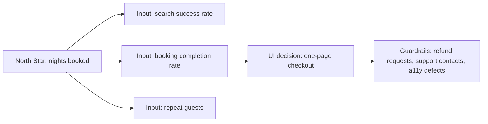

# North Star

A UI/UX decision is justified by the product outcome the spec names, not by taste. Find the North Star (or the spec's success criteria), pick the input metric the UI can actually move, pair it with guardrails that catch harm to users, and express the decision as scenarios dev can build and tdd can test. If the spec names no outcome or target, ask product; never invent one.

## North Star and input metrics

- North Star metric (NSM): one number that captures value delivered to users and tracks long-term success (classic example: nights booked for a lodging marketplace). It is owned by product, not by UI/UX.
- Input metrics: the few levers that drive the NSM and that a team can influence (e.g. search-to-listing-view rate, listing-to-booking conversion, repeat bookings).
- A UI change should target one input metric and state the expected direction, not the NSM directly.



Good NSMs reflect delivered value, are leading rather than lagging, and are understandable by everyone. Vanity metrics (page views, raw sign-ups, time on page) are poor targets because the UI can inflate them without helping users.

## Guardrails and Goodhart's law

When a measure becomes a target it stops being a good measure. Every metric a UI change targets needs counter metrics that would expose gaming:

| Target | Easy bad way to move it | Guardrail |
|---|---|---|
| Sign-up conversion | Pre-checked consent, hidden terms | Consent opt-out rate, complaints, legal review |
| Time in app | Infinite scroll, hard-to-find exit | Task completion time, self-reported satisfaction |
| Subscription retention | Cancellation maze (roach motel) | Cancellation completion time, chargebacks |
| Checkout completion | Removing price breakdown | Refunds, support tickets about price |
| Feature adoption | Modal nags on every visit | Dismiss rate, accessibility issues, churn |

Dark patterns are never an acceptable way to hit a metric. Accessibility is a requirement, so a change that raises conversion but breaks WCAG 2.2 AA fails.

## Mission and BHAG: direction, not acceptance

- A Big Hairy Audacious Goal or mission statement (10–30 year horizon) explains why the product exists. Use it to break ties between concepts and to reject designs that contradict it.
- It is too broad to test. Never write it into acceptance criteria; translate it through the spec's goals and success criteria.
- An unrealistic goal demotivates; if UI targets derived from it look impossible, raise it with product rather than quietly lowering quality.

## Balancing perspectives (Strategic Balanced Scorecard)

Optimizing one number tends to sacrifice others. Check each UI decision against the four scorecard perspectives:

| Perspective | UI/UX-relevant metrics |
|---|---|
| Financial | Conversion, average order value, cost per support contact |
| Customer | Task success rate, satisfaction (CSAT, NPS), retention, accessibility complaints |
| Internal process | Error rate, time on task, defect escape rate, page performance (Core Web Vitals) |
| Learning and growth | Design-system adoption, research cadence, time from insight to shipped change |

If a decision helps one perspective and hurts another, record the trade-off and let product decide.

## Instrumenting a decision

- Measure only what the decision needs: event name, trigger, properties, and which metric it feeds.
- Respect consent: analytics and experiments run only under the consent the product has obtained; no personal data in event names, URLs or query strings; follow the retention policy.
- Name events in the domain's language and keep a schema so dev and tdd share one definition.

```json
{
  "event": "checkout_completed",
  "trigger": "order confirmation shown",
  "properties": { "step_count": "integer", "payment_method_type": "string" },
  "feeds": "booking completion rate",
  "consent": "analytics"
}
```

## How much to design up front

| Approach | Fits when | Risk |
|---|---|---|
| Big design up front (BDUF) | Regulated flows, many dependencies, expensive changes (hardware, contracts) | Months of design that misses real needs; hard to pivot |
| Iterative / just enough | Uncertain needs, cheap deploys, measurable outcomes | Inconsistency and rework without shared foundations |

Practical middle: decide foundations up front (design tokens, component library, navigation model, accessibility baseline, vocabulary), design each flow just ahead of implementation, and revise from evidence.

## Domain language in the UI (DDD)

- Ubiquitous language: the UI uses the same terms as the domain model and the spec. If users say "booking" and code says "reservation", agree on one term with product and use it in labels, URLs, events and tests.
- Bounded contexts: the same word can mean different things in different areas (an "account" in billing vs in identity). Keep each context's meaning consistent on its own screens and avoid mixing them in one view without qualification.
- Entities appear as things users can open and track (an order with an ID and history); value objects are displayed and formatted (money, dates, addresses) and edited as a whole.
- Domain events ("order placed", "payment failed") are natural triggers for UI feedback and analytics events.

## From decision to test (BDD and TDD)

State each UI decision as behavior: define it in scenarios, implement to support them, validate against them. Scenarios use the domain language and come from the spec, not from the implementation.

```gherkin
Feature: One-page checkout
  Scenario: Guest completes checkout without creating an account
    Given my cart has 1 item
    When I enter shipping and payment details on the checkout page
    And I choose "Place order"
    Then I see the order confirmation with an order number
    And a "checkout_completed" event is recorded only if analytics consent was given
```

tdd turns these into failing tests first (red), dev makes them pass (green), then both refactor. Exploratory design spikes may skip test-first, but the chosen design gets scenarios before it ships.

## Decisions to hand off

| Decide | Dev implements | tdd / acceptance verifies |
|---|---|---|
| Which spec success criterion (SC-xxx) or input metric this UI change targets, and expected direction | Nothing directly; drives what to build | Traceability: scenario references the SC id |
| Guardrail metrics and forbidden tactics | Avoids listed patterns (no pre-checked consent, easy cancel path) | Tests for the guardrail behaviors (e.g. cancel reachable in N steps if spec sets N) |
| Analytics events and their consent category | Event emission per the schema, gated on consent | Test that events fire with correct properties, and do not fire without consent |
| UI vocabulary per bounded context | Labels, routes, event names use agreed terms | Copy and route assertions; glossary check in review |
| Up-front foundations vs deferred flow details | Tokens, components, navigation first | Design-system and accessibility checks in CI where available |
| Acceptance scenarios for the decision | Code satisfies each scenario | Automated Given/When/Then tests pass |
| Missing metric, target or trade-off call | Nothing | Open question to product/spec |

## Workflow

1. Read the spec's goals and success criteria; identify the NSM or SC this work serves. If none, raise an open question.
2. Choose the input metric the UI can move and the expected direction.
3. List guardrails across the scorecard perspectives; reject any option that relies on a dark pattern or breaks accessibility.
4. Decide what must be designed up front (foundations) and what can follow per flow.
5. Align UI terms with the domain glossary and bounded contexts.
6. Define instrumentation only as needed, with consent and privacy rules.
7. Write Given/When/Then scenarios for each decision and hand them to tdd and dev.
8. After release, compare the metric and guardrails against the expectation; feed results back to product.

## Red flags

- A UI change justified by "it will increase engagement" with no metric, baseline or target from the spec.
- Targets invented by the designer or agent rather than set by product.
- One metric optimized with no guardrails.
- Conversion gains that come from confusing, nagging or trapping users.
- Tracking added without consent handling, or personal data in event payloads or URLs.
- Mission statements pasted into acceptance criteria.
- UI labels, routes and code using different words for the same thing.
- Months of pixel-perfect design before any user feedback, or no shared foundations at all.
- Acceptance criteria written in implementation terms ("the div has class active") instead of behavior.

## Related

- `../../actions/uiux.md` — the workflow that consumes this skill and records its decisions.
- `../UiUxFoundations/uiUxFoundations.md` — user-centered design principles behind the metrics.
- `../ProductDesign/productDesign.md` — product goals and roadmapping that set the outcome.
- `../Ideation/ideation.md` — generating options to converge against these metrics.
- `../Testing/testing.md` — split tests, analytics and usability tests that measure outcomes.
- `../Affordance/affordance.md` — dark patterns and accessibility requirements used as guardrails.
- `../ArtificialIntelligence/artificialIntelligence.md` — consent and privacy when AI features affect metrics.
- `../../actions/tdd.md` — turning scenarios into failing tests first.
- `../../actions/dev.md` — implementing the decision against the scenarios.
- `../../ProductDefinition/specs/spec-definition.md` — success criteria (SC-xxx) and the rule against invented targets (when installed).
- `../../TDD/Patterns/TDDPatterns/tddPatterns.md` — test lists for the scenarios (when installed).
