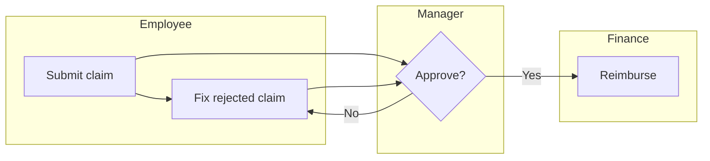

# Task Analysis

Task analysis turns "the user wants to do X" into an explicit tree of goals, subtasks, steps and decisions, with the order, conditions, actors and failure points for each. Build it from observation and the spec, review it with people who do the task, then design the UI so each step is visible, each decision has the information it needs, each likely error is prevented or recoverable, and every step and branch is something tdd can assert.

## General process

1. **Pick the task** and its boundary: the goal, the start trigger, the end state, the actor (from the spec).
2. **Collect** how it is done today: observe people doing it, interview SMEs and frequent users, read existing docs, support tickets and logs.
3. **Decompose** from the top goal down to discrete, meaningful actions. Stop when a step maps to a single UI action or system response.
4. **Sequence**: order, dependencies, conditions, optional and repeated steps.
5. **Document** as an HTA outline, flowchart or swimlane.
6. **Evaluate** with practitioners: missing steps, redundant steps, unclear points, workarounds.
7. **Improve**: remove, merge, default or automate steps; add guidance where errors cluster. Record which improvements need product approval.

## Hierarchical Task Analysis (HTA)

- Numbered goals and subtasks, each with a **plan** that says how its children run: in order, in any order, conditionally, or repeated.
- Each leaf is an operation: one user action or one system response. Leaves are what screens, controls and tests are built from.
- Mark for each leaf: who does it, what information it needs, what can go wrong, and how the system responds.

```text
0. Submit an expense claim
   Plan 0: do 1-2-3; do 4 if total > approval limit; then 5
   1. Start claim (choose period, project)
   2. Add expenses (repeat until done)
      Plan 2: 2.1 then 2.2; 2.3 if receipt required
      2.1 Enter amount, date, category
      2.2 Choose payment method
      2.3 Attach receipt (photo or file)
   3. Review totals and policy warnings
   4. Add justification for manager
   5. Submit; see confirmation and status
```

From this HTA: step 2 needs "add another" and a running total; 2.3 needs camera and file input plus a clear rule for when a receipt is required (an SME rule, with its source); plan 0 needs the approval limit from the spec, and if the spec does not state it, that is an open question.

## Cognitive Task Analysis (CTA)

Observable steps miss what users think: the cues they look for, the rules of thumb they apply, the decisions where experts and novices differ.

| Technique | Use it to |
|---|---|
| Expert interviews with open questions | Learn strategies and decision rules |
| Think-aloud while doing the task | Hear expectations, confusion and reasoning in the moment |
| Scenario probes (cognitive task interviews) | Ask "what would you do if..." for rare or risky cases |
| Knowledge elicitation (concept maps, decision trees) | Capture tacit knowledge as structures you can implement |
| Cognitive work analysis | Relate mental models to the organizational context and constraints |
| Workload assessment (for example NASA-TLX ratings, error rates, time) | Find steps that overload memory or attention |

Design consequences: show the cues experts rely on at the decision point; do not make users remember information from a previous screen (recognition over recall); split or simplify steps with high workload; give novices guidance that experts can skip.

## Workflow (process) analysis

When a task spans several people or systems, map the whole workflow:

- **Map** activities, decision points and data flow, one swimlane per role or system.
- **Per activity**: purpose, inputs, outputs, resources.
- **Time**: duration and waiting time per step; find bottlenecks (from observation, interviews or logs).
- **Data flow**: where data originates, how it moves, where it is re-entered by hand.
- **Roles**: who owns each step, where handoffs happen, where effort is duplicated or ownership unclear.
- **Decisions**: criteria and rules at each decision point.
- **Controls**: how the workflow is monitored and improved (metrics, feedback).



Each handoff is a notification and a status the UI must show to both sides; each loop (reject and resubmit) needs a clear reason and a way to act on it.

## Critical Incident Technique (CIT)

- Define what counts as critical (for example a failed payment, a missed deadline, an unusually smooth success).
- Collect concrete stories from people who lived them: what happened, who was involved, what they did, the result.
- Select a varied set, code each for factors, cluster into themes, then interpret and validate with SMEs.
- Use the themes to rank which error paths and edge cases the design must handle first; each theme should map to at least one error-state decision and one test.

## Diary studies

- Use when behavior unfolds over days or weeks (habits, recurring tasks, onboarding, intermittent use) or happens in contexts you cannot observe.
- Recruit representative participants, give clear prompts on what to record and how often, allow text, audio or photo entries, follow up with interviews, analyze for themes, and report with quotes.
- Diary entries contain personal data: get informed consent, collect the minimum, and anonymize before sharing.

## Anticipatory design

Predicting needs can remove steps, but it acts on the user's behalf, so it carries obligations.

- Techniques: context-aware defaults (locale, last used values), predictions from usage, automation (autofill, scheduling), assistants, interfaces that adapt to the user.
- Rules: use only data the user has agreed to share for this purpose; show what was prefilled or suggested and why; make every prediction easy to change, undo or turn off; never auto-commit consequential actions (payments, sending messages, deleting data) without explicit confirmation; behave sensibly when there is no data (cold start).
- Adaptive layouts must not move controls unpredictably, since that breaks memorability and assistive-technology users.
- Whether to personalize at all, and with which data, is a product and privacy decision: ask if the spec does not say.

```tsx
<input name="currency" defaultValue={lastUsedCurrency ?? localeCurrency} />
<small>Prefilled from your last claim. You can change it.</small>
```

## Decisions to hand off

| Decide | Dev implements | TDD / acceptance verifies |
|---|---|---|
| Task boundary: goal, trigger, end state, actor | Entry point and completion screen | E2E from trigger to end state per actor |
| HTA leaves and plans (order, conditions, repeats) | Steps, conditional sections, "add another" loops | One test per plan branch and per repeat case |
| Step budget for the primary task | Flow within that many steps or screens | E2E asserts step count; regression if steps added |
| Information needed at each decision point | Data shown on the same screen as the decision | Component test that the cue is visible at that step |
| Error and recovery per risky step (from CIT and CTA) | Prevention, validation, messages, retry or undo | Tests for each listed error path |
| Roles, handoffs and statuses across the workflow | Status model, notifications, permissions per role | Tests per transition and per role; notification sent on handoff |
| Steps removed, defaulted or automated | Defaults, autofill, automation with visible explanation | Tests that defaults are applied, editable and reversible |
| Anticipatory features: data used, consent, override, cold start | Opt-in setting, explanation, undo, fallback | Tests for opt-out, cold start, no auto-commit of consequential actions |
| Unknown rules or thresholds (for example approval limits) | Nothing until product answers | Logged as open questions for product |

## Workflow

1. Take the primary task and actor from the approved spec; confirm the boundary.
2. Gather evidence: observation, SME and user interviews, logs, tickets; use CIT for failures and diary studies for long-running behavior, with consent.
3. Build the HTA with plans; add CTA findings at decision points.
4. If several roles or systems are involved, draw the workflow with swimlanes, timings and handoffs.
5. Review the analysis with people who do the task; fix gaps.
6. Improve: cut, merge, default or automate steps; place cues at decisions; design prevention and recovery for likely errors. Send scope or policy changes to product.
7. Translate leaves, branches, handoffs and error paths into the decisions table and acceptance scenarios for dev and tdd.

## Red flags

- A flow designed from the database schema or API sequence instead of the user's task.
- HTA without plans, so conditions and repeats are invisible and untested.
- Steps that require remembering data from an earlier screen.
- Decision points with no information to decide; experts' cues missing.
- Handoffs with no status or notification; rejected items with no reason.
- Edge cases chosen by guesswork when incident data exists.
- Predictions or automation that act without consent, cannot be undone, or commit payments or messages silently.
- Thresholds and rules invented in the UI because the spec was silent.

## Related

- `../../actions/uiux.md` — the workflow that consumes this skill and records the decisions.
- `../UiUxFoundations/uiUxFoundations.md` — usability attributes and accessibility the step design must meet.
- `../DesignThinking/designThinking.md` — personas, journeys and SME input that feed the analysis.
- `../ModelingDiagrams/modelingDiagrams.md` — flowcharts, swimlanes and state diagrams for documenting tasks.
- `../ArtificialIntelligence/artificialIntelligence.md` — AI-driven predictions and assistants beyond simple defaults.
- `../Testing/testing.md` — usability testing of the redesigned flow.
- `../../ProductDefinition/specs/spec-checklist.md` — where missing rules and thresholds are raised (when installed).
- `../../TDD/Patterns/TDDPatterns/tddPatterns.md` — turning plan branches and error paths into a test list (when installed).
