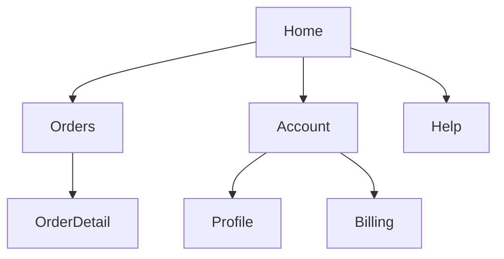

# UI/UX Foundations

UI is what people see and operate; UX is whether they reach their goal with that UI easily and with confidence. Every UI/UX decision starts from a named user, their goal and their context as stated in the spec, is judged against usability and accessibility criteria that dev can implement and tdd can test, and goes back to product as an open question whenever the spec is silent about who the user is or what they are trying to do.

## UI, UX, CX and DX: pick the right lens

| Lens | Scope | Typical decisions | Evidence of success |
|---|---|---|---|
| UI | Screens, controls, layout, typography, color, states | Component choice, visual hierarchy, spacing, empty/loading/error states | Visual review against design system; component tests |
| UX | The whole interaction toward a goal | Flow, step count, IA, feedback, error recovery | Task success rate, time on task, errors per task |
| CX | Every touchpoint with the organization (app, email, support, store) | Consistent terms and states across channels, handoffs between channels | Same order status shown everywhere; support scripts match UI copy |
| DX | Developers as users of APIs, SDKs, CLIs, docs | Naming, error messages, defaults, docs and examples, compatibility | Time to first successful call; actionable error payloads |

- Treat a public API, CLI or SDK as a UI: its users are developers, and usability rules apply (consistent naming, clear errors, safe defaults, examples that run).
- CX decisions often cross team boundaries (email templates, support tooling). Record them, but flag owners outside the feature as open questions.

## User-centered design (UCD)

- Users, goals and context of use come from the spec or product plan. Never invent a persona, environment or motive; if the spec lacks them, ask.
- Context of use includes: physical setting (mobile on the move, kiosk, desk), user characteristics (expertise, language, disabilities), technical constraints (device, bandwidth, assistive tech) and social or cultural factors.
- Involve real users early and repeatedly: interviews and observation before design, usability tests on prototypes, feedback after release. Any study with real users needs informed consent and handling of personal data that matches the privacy policy.
- Design with the whole team: designers, developers, researchers, product and support. Technical feasibility and business goals are constraints on the design, not afterthoughts.
- Iterate: prototype, test, revise. A decision without a way to check it is an opinion.

## Usability: five attributes to design and test against

| Attribute | Design move | Testable criterion (example) |
|---|---|---|
| Learnability | Familiar patterns, visible options, clear labels, onboarding only where needed | First-time users complete the primary task without help in a moderated test |
| Efficiency | Fewer steps, sensible defaults, shortcuts and bulk actions for experts | Primary task takes no more than N steps; keyboard shortcut exists for the most frequent action |
| Memorability | Consistent layout and terminology, stable navigation | Same action has the same label and position on every screen |
| Errors | Prevent first (constraints, confirmation for destructive actions), then explain and recover (inline messages, undo) | Invalid input shows a message naming the field and the fix; delete offers undo for N seconds |
| Satisfaction | Responsive feedback, calm visuals, no surprises | Every action gives visible feedback promptly; post-task rating collected in tests |

Pair these with Nielsen's heuristics: visibility of system status, match with the real world, user control and freedom, consistency and standards, error prevention, recognition over recall, flexibility and efficiency, minimalist design, help users recover from errors, help and documentation.

```tsx
// Error message tied to its field and announced to assistive tech.
<label htmlFor="email">Email</label>
<input id="email" type="email" aria-invalid={!!error} aria-describedby="email-error" />
{error && <p id="email-error" role="alert">Enter an email like name@example.com.</p>}
```

## Accessibility is a requirement

- Default target: WCAG 2.2 level AA, unless the spec or applicable law sets a stricter one. Which legal regime applies (ADA, EN 301 549, the European Accessibility Act, others) is a product decision; ask if unknown.
- POUR principles, with the checks dev and tdd use most often:
  - **Perceivable**: text alternatives for meaningful images (`alt`; empty `alt=""` for decorative ones); captions for video; text contrast at least 4.5:1 (3:1 for large text and for UI component boundaries); never convey meaning by color alone; content reflows at 320 CSS px wide.
  - **Operable**: everything works with the keyboard; visible focus indicator not hidden by sticky content; no keyboard traps; target size at least 24x24 CSS px; time limits can be extended; alternatives to dragging.
  - **Understandable**: page language set (`<html lang>`); labels and instructions on inputs; consistent navigation; errors identified in text with a suggestion; no unexpected context change on focus or input.
  - **Robust**: semantic HTML first (`button`, `nav`, `main`, `label`); ARIA only when no native element fits, following WAI-ARIA Authoring Practices; name, role and value exposed for custom widgets; status messages use live regions.
- Test automatically (axe-core, Lighthouse) and manually (keyboard-only pass, screen reader smoke test). Automated tools catch only part of the issues.

```ts
// Playwright + axe: fail on WCAG A/AA violations for a page.
const results = await new AxeBuilder({ page })
  .withTags(["wcag2a", "wcag2aa", "wcag21aa", "wcag22aa"])
  .analyze();
expect(results.violations).toEqual([]);
```

## Information architecture (IA)

- **Structure**: group content the way users think about it (their mental model, from research or the spec's domain language), not the way the database or org chart is organized.
- **Navigation**: global nav for top-level areas, local nav within an area, breadcrumbs for deep hierarchies, and a way back from every screen. Keep top-level choices few and distinct.
- **Labels**: use the user's words; one term per concept across UI, docs, emails and support (keep a glossary). A label should predict what the user finds after selecting it.
- **Search**: decide whether search is needed (large or unpredictable content sets); define scope, matching (prefix, typo tolerance), empty-result behavior and what is measured (queries with zero results).
- **Content strategy**: who writes, reviews, updates and retires each content type. Unowned content becomes wrong content.
- Validate IA with card sorting (to discover groupings) and tree testing (to check users can find items in the proposed hierarchy).



## Decisions to hand off

| Decide | Dev implements | TDD / acceptance verifies |
|---|---|---|
| Primary users, goals and context of use (copied from spec, not invented) | Supported devices, breakpoints, input modes | Acceptance scenarios name the user and goal; responsive tests at agreed breakpoints |
| Accessibility target (WCAG 2.2 AA unless spec says otherwise) | Semantic markup, labels, focus management, contrast tokens | axe scan with zero A/AA violations; keyboard-only E2E for the primary task; contrast check on tokens |
| Usability budget for the primary task (max steps, defaults, shortcuts) | Flow with that number of steps; defaults prefilled | E2E counts steps; tests assert defaults and shortcuts |
| Error prevention and recovery per destructive or risky action | Confirmation or undo; inline validation; field-level messages | Tests for invalid-input messages, undo restoring state, confirmation before destructive action |
| System status feedback (loading, success, failure, empty) | Each state rendered for every async view | Component test per state; status announced via live region |
| IA: navigation placement, labels and glossary | Routes, nav components, copy taken from glossary | Route tests; copy tests that labels match glossary; tree-test result recorded |
| Search scope and empty-result behavior (if search is in scope) | Query handling and empty state | Tests for zero results and, if decided, typo tolerance |
| DX contract for any API or CLI exposed (naming, errors, defaults) | Consistent names; error payloads with code, message and fix | Contract tests on error shape and defaults |
| Open questions for product (unknown user, legal a11y target, channel ownership) | Nothing until answered | Listed in the UI/UX decisions record as blocking |

## Workflow

1. Read the approved spec and spec-checklist; extract users, goals, context of use and constraints. Anything missing becomes an open question for product.
2. Choose the lens (UI, UX, CX, DX) for each part of the feature and note cross-channel or cross-team items.
3. Set the accessibility target and list the WCAG checks that apply to the new UI.
4. For the primary task, set measurable criteria for the usability attributes that matter most.
5. Define or extend the IA: where the feature lives, its navigation entry, labels from the glossary.
6. Specify every state (empty, loading, partial, success, error, offline if relevant) and the feedback for each.
7. Write the decisions table and hand it to dev and tdd; plan a usability check with representative users when risk warrants it, with their consent.
8. After release, compare measured behavior (task success, errors, zero-result searches) against the criteria and iterate.

## Red flags

- Personas, goals or contexts invented by the designer or agent instead of taken from the spec or research.
- "Make it intuitive" or "user-friendly" with no measurable criterion.
- Accessibility deferred to a later phase, or reduced to an automated scan.
- `div` with click handlers instead of `button`; ARIA roles added to redo what native elements already do.
- Meaning carried only by color; placeholder text used as the only label.
- Navigation mirroring the database schema or org chart; one concept named differently on two screens.
- Destructive actions with neither confirmation nor undo; errors shown only in a toast that disappears.
- Usability tests or analytics on real users without consent.
- Business metrics (sign-ups, purchases) pursued through tricks that work against the user's goal.

## Related

- `../../actions/uiux.md` — the workflow that consumes this skill and records the decisions.
- `../DesignThinking/designThinking.md` — research and framing methods (personas, journeys, VoC) that supply users and goals.
- `../TaskAnalysis/taskAnalysis.md` — breaking the primary task into steps to set the usability budget.
- `../Affordance/affordance.md` — UI patterns, ARIA and WCAG detail, and dark patterns to refuse.
- `../Implementation/implementation.md` — turning these decisions into components and design tokens.
- `../Testing/testing.md` — usability, accessibility and acceptance testing of the decisions.
- `../Internationalization/internationalization.md` — labels and IA that must survive translation.
- `../../ProductDefinition/specs/spec-definition.md` — where users, goals and constraints are defined (when installed).
- `../../ProductDefinition/specs/spec-checklist.md` — gaps found here become open questions (when installed).
- `../../CleanCode/ErrorHandling/errorHandling.md` — error design behind user-facing error messages (when installed).
