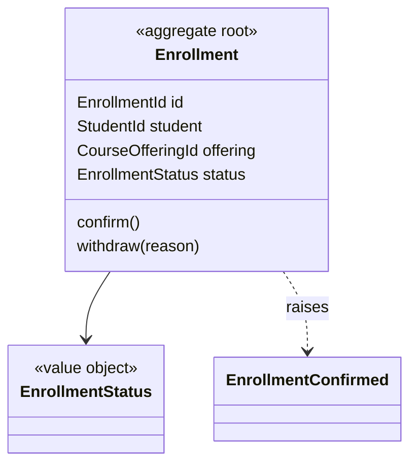

# ddd — Domain Model and Ubiquitous Language

## Purpose and ownership

Decide what the domain concepts are, what they are called, which rules each one protects, and where each boundary lies, before scenarios, screens, or code are written. The result lets `bdd` write scenarios in the same words, `uiux` label the interface consistently, and `dev` implement a model instead of scattering rules across controllers and queries.

`ddd` owns the **domain model record** (`DomainModel.md`) and the project's **glossary** of the ubiquitous language. It does not change product intent, write production code, or write tests.

## Position in the workflow

```text
plan → spec-definition → spec-checklist → ddd → bdd → uiux → dev
                                                              ├─ outer loop: bdd scenario
                                                              └─ inner loop: tdd ⇄ dev
                                                            → review → other skills
```

Run `ddd` when the scoped work introduces or changes domain concepts, business rules, invariants, lifecycles, or the boundary between parts of the system: a new entity or value, a new rule on an existing one, a new workflow or state machine, a new integration with another context.

Skip it when the change does not touch the model: copy or styling changes, chores, infrastructure work, or a bug fix inside an existing, correctly modeled rule. In that case `dev` records "DDD: not applicable" and proceeds.

## Skill boundaries

- `plan`, `spec-definition`, `spec-checklist`: decide **what** the product must do and **why**. `ddd` treats their decisions as fixed and refines the spec's Key Entities into a model.
- `ddd`: decides the concepts, their names, their boundaries, and the rules each object enforces.
- `bdd`: writes scenarios in the ubiquitous language. New terms or rules discovered there come back to `ddd`.
- `uiux`: uses the glossary for labels and copy where the domain term is meaningful to users.
- `dev`: implements the model in code, keeping names, aggregate boundaries, and layers as recorded.
- `tdd`: tests domain objects and invariants through their public behavior.
- `review`: checks the code against the model: names, boundaries, layering, and invariants.

Do not copy another skill's full workflow into this skill. Invoke it and use its output.

## Inputs and source of truth

- The approved specification (`SpecifyRequirements.md`): user stories, functional requirements, domain rules and invariants, Key Entities, edge cases.
- The `spec-checklist` result. Only items marked **Ready** may be modeled.
- The existing model in the code: domain modules, entities, value types, services, repositories, events, and their names. The code is the current model, whatever older documents say.
- The existing glossary (`docs/glossary.md` or the project's equivalent) and any context map or architecture decision records.
- Domain experts: the user, the product owner, or the people the spec names. Their words are the starting point for the language.

Never fill a gap in business knowledge with a modeling guess. A question about how the business works is a product question: send it back to `spec-definition`.

## Reference library

When `DDD/README.md` is installed, it routes to one skill per chapter of *Domain-Driven Design*. Read only the skills that match the step you are on:

| Step | Skills |
|---|---|
| Learning the domain and naming things | `DDD/ModelInPractice/CrunchingKnowledge/crunchingKnowledge.md`, `DDD/ModelInPractice/UbiquitousLanguage/ubiquitousLanguage.md` |
| Keeping model and code the same thing | `DDD/ModelInPractice/ModelDrivenDesign/modelDrivenDesign.md` |
| Layers and keeping the domain isolated | `DDD/BuildingBlocks/IsolatingTheDomain/isolatingTheDomain.md` |
| Entities, value objects, services, modules | `DDD/BuildingBlocks/ModelInSoftware/modelInSoftware.md` |
| Aggregates, factories, repositories | `DDD/BuildingBlocks/DomainObjectLifecycle/domainObjectLifecycle.md` |
| Applying the building blocks end to end | `DDD/BuildingBlocks/WorkedExample/workedExample.md` |
| Rules, constraints, processes, specifications | `DDD/DeeperInsight/ImplicitConcepts/implicitConcepts.md` |
| Making the model easy to change and combine | `DDD/DeeperInsight/SuppleDesign/suppleDesign.md` |
| Reusing known models and design patterns | `DDD/DeeperInsight/AnalysisPatterns/analysisPatterns.md`, `DDD/DeeperInsight/DesignPatternsInTheModel/designPatternsInTheModel.md` |
| Refactoring when a better model appears | `DDD/DeeperInsight/Breakthrough/breakthrough.md`, `DDD/DeeperInsight/BringingThePiecesTogether/bringingThePiecesTogether.md` |
| Bounded contexts and context maps | `DDD/StrategicDesign/ModelIntegrity/modelIntegrity.md` |
| Core domain vs supporting and generic parts | `DDD/StrategicDesign/Distillation/distillation.md` |
| System-wide structure and strategy | `DDD/StrategicDesign/LargeScaleStructure/largeScaleStructure.md`, `DDD/StrategicDesign/BringingTheStrategyTogether/bringingTheStrategyTogether.md` |

## Workflow

### 1. Confirm readiness and scope

List the requirement and user-story IDs in scope and confirm the checklist marks them **Ready**. Identify which domain rules and Key Entities they touch.

### 2. Read the current model

Find the existing domain code, module boundaries, glossary, and context map. Note where the code's names differ from the spec's and the experts' words; those differences are modeling questions, not typos.

### 3. Place the change in a bounded context

Decide which bounded context owns each concept. If the change spans contexts, name the relationship (shared kernel, customer/supplier, conformist, anti-corruption layer, open host service, published language, separate ways) and which side translates. When the project has no explicit contexts yet, record the implicit one rather than inventing a new architecture.

### 4. Settle the language

Update the glossary with each term in scope: its meaning in this context, its synonyms to avoid, and the code name it maps to. One word, one meaning, per context. Ask the domain expert when two words compete; record the answer.

### 5. Model the building blocks

For each concept decide, with a reason:

- **Entity** or **value object**: does identity matter over time, or only the attributes?
- **Aggregate**: which objects change together under one invariant, and which is the root. Keep aggregates small, reference other aggregates by identity, and change one aggregate per transaction; use domain events and eventual consistency between aggregates when the business accepts it.
- **Invariants**: the rules the aggregate root enforces on every change, stated so `tdd` can test them.
- **Domain service**: an operation that does not belong to any one entity or value.
- **Domain events**: facts other parts of the system react to, named in the past tense.
- **Factory** and **repository**: how aggregates are created whole and retrieved by root, expressed as domain interfaces.
- **Specification** objects for rules that select, validate, or build.

Sketch the model as a Mermaid class diagram when it helps the reader.



### 6. Place the pieces in layers

Map every element to a layer (domain, application, infrastructure, interface) or to the ports and adapters the project uses. Domain objects depend on nothing outside the domain; persistence, messaging, and frameworks stay at the edges. Follow the project's existing architecture when it already makes this decision.

### 7. Resolve open questions

- Business question: return it to `spec-definition` or the product plan.
- Modeling question with real alternatives: ask the user one focused question with a recommendation and the trade-off.
- Record every answer as a decision.

### 8. Write the record and hand off

Write `DomainModel.md` next to `SpecifyRequirements.md` (or where the user asks) and update the glossary, then hand off.

## Output format

```markdown
# Domain Model: [FEATURE NAME]

**Status:** Draft | Ready for Implementation | Blocked on Clarification
**Specification:** [path] — requirements covered: FR-01, FR-02, US-1, ...

## 1. Bounded Context
The owning context, and relationships to other contexts (with a context map if more than one).

## 2. Ubiquitous Language
| Term | Meaning in this context | Avoid | Code name |

## 3. Model
Entities, value objects, aggregates (root, members, invariants), domain services, domain events, factories, repositories, specifications — each traced to requirement IDs. Diagram optional.

## 4. Invariants
DM-01 ... each a testable rule enforced by a named aggregate root or value object.

## 5. Layer and Module Placement
Where each element lives in the codebase; existing modules reused or extended.

## 6. Integration and Translation
What crosses context boundaries, in which direction, and where translation happens.

## 7. Implementation Notes for Dev
Transaction boundaries, persistence mapping concerns, events to publish, what must not leak into the domain layer.

## 8. Decisions Log and Open Questions
Decisions with their source (spec, expert, existing code).
**Open Questions: None.** (required for Ready for Implementation)
```

Omit sections that do not apply. Give every invariant a stable `DM-NN` ID.

## Handoff to bdd, uiux, and dev

Point to the record instead of copying it:

- **Record and glossary:** paths and status.
- **Context:** the owning bounded context and any translation at its edges.
- **Terms to use:** the glossary entries `bdd` and `uiux` must use.
- **Invariants:** the `DM` IDs `tdd` should test first.
- **Must-follow decisions:** aggregate boundaries, layer placement, and integration choices whose violation would most damage the model.

`dev` then implements the model with the recorded names, aggregate boundaries, and layers. When the code reveals that the model is wrong or awkward, `dev` stops on that item and returns to `ddd` and the user; the model and the code change together.

## Guardrails

- Never change product intent or business rules, and never invent domain knowledge.
- Do not create a bounded context, microservice, or new architecture style the project does not need; record the smallest boundary decision that serves the change.
- Do not let persistence, framework, or transport concerns shape domain names or invariants.
- Do not model everything up front; model what the scoped requirements need, and leave the rest to later changes.
- Do not write production code or tests.
- Preserve unrelated user changes in the repository.

## Completion criteria

Domain modeling is complete when every ready requirement in scope maps to named model elements in one bounded context, the glossary covers every term in scope, every invariant is stated and testable, each element has a layer, cross-context translation is explicit, the record says **Open Questions: None.**, and `bdd`, `uiux`, and `dev` have a concise handoff.
