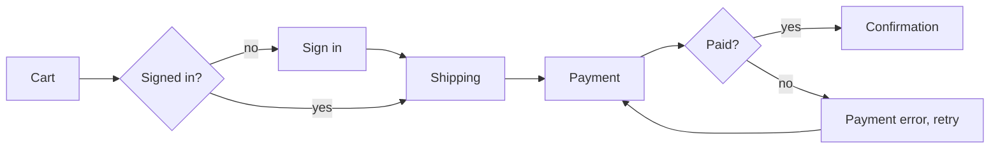

# uiux — UI/UX Decisions and Design Handoff

## Purpose and ownership

Decide how the specified behavior is presented to and operated by its users, and record those decisions so `dev` implements them instead of improvising design choices, and `tdd` knows which user-facing behaviors to test.

`uiux` owns the **UI/UX decisions record** (`UIUXDecisions.md`). It does not change product intent, write requirements, write production code, or write tests.

## Position in the workflow

```text
plan → spec-definition → spec-checklist → bdd → uiux → dev ─┬─ TDD mode: tdd ⇄ dev
                                                            └─ direct mode
                                                        → review → other skills
```

Run `uiux` when the scoped work adds or changes anything a person sees or operates: screens, pages, components, forms, navigation, notifications, emails, copy, error messages, or CLI output meant for people.

Skip it when the change has no user-facing surface (an internal job, a refactor with identical output, a backend contract with no UI change). In that case `dev` records "UI/UX: not applicable" and proceeds.

## Skill boundaries

- `plan`, `spec-definition`, `spec-checklist`: decide **what** the product must do and **why**. `uiux` treats their decisions as fixed.
- `uiux`: decides **how** that behavior looks, reads, and responds for the user, and **how dev should approach building it**.
- `tdd`: turns the record's UI acceptance checks into executable tests.
- `dev`: implements production code following the record. Ordinary engineering choices remain `dev`'s; a deviation from a recorded UI decision comes back to `uiux` and the user.
- `review`: checks the implementation against the record, including states and accessibility.

Do not copy another skill's full workflow into this skill. Invoke it and use its output.

## Inputs and source of truth

- The approved specification (`SpecifyRequirements.md`) and its requirement and user-story IDs.
- The `spec-checklist` result. Only items marked **Ready** may be designed; items marked **Needs clarification** that affect the UI block the affected decisions.
- The product plan, for goals, target users, platforms, and success criteria.
- The `bdd` feature files and scenario IDs, when they exist. They already state the business rules and expected outcomes; reference them instead of restating them, and add only UI-specific decisions and checks.
- The existing interface in the repository: design system or component library, design tokens, style guide, routes and layouts, i18n setup, accessibility tooling, and the end-to-end and component test frameworks and their selector conventions.
- External guidelines the project already follows (brand guide, Apple HIG, Material Design, GOV.UK, an internal pattern library).

Never fill a product gap with a design decision. If a choice would change scope, business rules, permissions, data handling, or success criteria, it is a product question: send it back to `spec-definition` or the product plan.

## Reference library

When `UIUX/README.md` is installed, it routes to one skill per section of the *UI/UX Design Guide*. Read only the skills that match the step you are on:

| Step | Skills |
|---|---|
| Users, tasks, and flows | `UIUX/UiUxFoundations/uiUxFoundations.md`, `UIUX/TaskAnalysis/taskAnalysis.md`, `UIUX/ModelingDiagrams/modelingDiagrams.md` |
| Exploring options when the approach is unclear | `UIUX/DesignThinking/designThinking.md`, `UIUX/Ideation/ideation.md`, `UIUX/NorthStar/northStar.md` |
| Screens, prototypes, priorities, cognitive load | `UIUX/ProductDesign/productDesign.md` |
| Reusing the design system and platform guidelines | `UIUX/DesignManagement/designManagement.md` |
| UI patterns, accessibility, ARIA, WCAG, dark patterns | `UIUX/Affordance/affordance.md` |
| Typography, copy, grids, responsive, progressive enhancement | `UIUX/Implementation/implementation.md` |
| Locales, formatting, right-to-left text | `UIUX/Internationalization/internationalization.md` |
| AI-assisted features | `UIUX/ArtificialIntelligence/artificialIntelligence.md` |
| Acceptance, end-to-end, accessibility, and localization tests | `UIUX/Testing/testing.md` |
| Scope trade-offs and stakeholder work | `UIUX/PrinciplesAndIdioms/principlesAndIdioms.md`, `UIUX/SoftSkills/softSkills.md` |

## Workflow

### 1. Confirm readiness and scope

List the requirement and user-story IDs with a user-facing effect. Confirm the checklist marks them **Ready**. If a UI-affecting item is blocked, stop for that item and report the question; independent, ready items may proceed.

### 2. Inspect the existing interface

Find what already exists before deciding anything new: components that fit, tokens for color, spacing, and type, layout and navigation patterns, form and validation conventions, empty and error state patterns, translation keys and locale setup, accessibility linting, and how tests select elements. Consistency with the existing product beats local novelty. Reuse first; extend second; create new components only when nothing fits, and say why.

### 3. Map users, tasks, and flows

For each user story, identify the actor, their goal, the steps, the decision points, and the failure paths. Express each flow as a short list or a Mermaid diagram so `dev` and `tdd` can read it in the repository.



### 4. Decide screens, components, and states

For every screen or component in scope, decide:

- Information architecture: what appears, in what order, and what is primary.
- Components: which existing component is used, or what new one is needed.
- States: default, loading, empty, partial, success, validation error, system error, disabled, permission denied, and offline or slow network where relevant. Every specified failure scenario needs a visible state.
- Interaction rules: what triggers what, when validation runs, how feedback appears, focus movement, confirmation for destructive actions, and undo where it is cheaper than confirmation.
- Content: labels, help text, empty-state text, error messages that say what happened and how to fix it, in the product's voice. Use translation keys when the project is localized.

### 5. Decide cross-cutting qualities

- **Accessibility target.** Use the level the product or spec set. If none is set, propose WCAG 2.2 AA and confirm it with the user; do not settle it silently. Record per-component requirements: keyboard operation, visible focus, accessible names, roles and ARIA only where native HTML is not enough, contrast, text resizing, reduced motion, and screen reader announcements for dynamic changes.
- **Devices and layout.** Use the target devices and platforms from the product plan to choose mobile-first or desktop-first, breakpoints, touch target sizes, and whether progressive enhancement is required (core task works without JavaScript or on poor networks).
- **Internationalization.** Use the locales from the plan. Decide formatting of dates, numbers, and currency, text expansion allowance, pluralization, and right-to-left support.
- **Measurement.** Add analytics events, experiments, or heatmaps only when the spec's success criteria require them, and respect the spec's privacy and consent rules.
- **AI-assisted behavior.** When the spec includes it, decide how AI output is labeled, reviewed, corrected, and declined by the user.

Never choose a dark pattern (hidden costs, forced continuity, confirm-shaming, disguised ads, pre-checked consent, obstruction to cancel), even when it would improve a metric.

### 6. Resolve open questions

- Product-level question: return it to `spec-definition` or the product plan. Do not decide it here.
- Design-level question: ask the user one focused question at a time, with a recommendation and the trade-off.
- Record every answer as a decision. Do not interpret silence as consent.

### 7. Choose the implementation approach for dev

This is the part `dev` acts on. Decide and record:

- **Mode.** Recommend TDD mode (via `tdd`) or direct mode, with the reason. Recommend TDD mode for behavior with rules, states, validation, formatting, permissions, or critical flows; direct mode only for low-risk presentational changes.
- **Slice order.** Build the P1 flow end to end first as a thin walking skeleton, then add states, then lower-priority stories. Each slice should be demonstrable.
- **Test levels.** Map each acceptance check to the lowest level that proves it: unit for formatting and validation logic, component tests for states and interactions, end-to-end for critical flows, automated accessibility checks for every new screen, and a manual keyboard and screen reader pass for P1 flows.
- **Constraints.** Components to reuse, tokens to use instead of literal values, conventions for test selectors (prefer accessible roles and labels), and things `dev` must not do (new component libraries, inline styles, hard-coded strings in a localized app).

### 8. Write the record and gate the handoff

Write `UIUXDecisions.md` next to `SpecifyRequirements.md` (or where the user asks) using the format below, then apply the gate.

## Output format

```markdown
# UI/UX Decisions: [FEATURE NAME]

**Status:** Draft | Ready for Implementation | Blocked on Clarification
**Specification:** [path] — requirements covered: FR-01, FR-02, US-1, ...

## 1. Scope and Surfaces
Screens, components, and channels in scope; explicitly out of scope.

## 2. Users, Tasks, and Flows
One flow per user story (list or Mermaid), including failure paths.

## 3. Screens and Components
| Screen / component | Requirements | Component (reuse / extend / new) | States | Notes |

## 4. Interaction and Feedback Rules
UX-01 ... each a testable rule: trigger, response, feedback, focus.

## 5. Content and Microcopy
Labels, messages, empty and error text, or the translation keys that hold them.

## 6. Accessibility
Target level and per-component requirements.

## 7. Layout, Devices, and Progressive Enhancement

## 8. Internationalization
Locales, formatting, text expansion, right-to-left.

## 9. Design System Impact
New or changed tokens and components, and who must approve them.

## 10. Implementation Approach for Dev
Mode and reason, slice order, constraints, must-not-do.

## 11. UI Acceptance Checks for TDD
| ID | Given / When / Then | Requirement / UX ID | Test level |

## 12. Decisions Log and Open Questions
Decisions with their source (spec, user, existing convention).
**Open Questions: None.** (required for Ready for Implementation)
```

Omit sections that do not apply, and say "not applicable" rather than leaving them empty. Give every decision a stable `UX-NN` ID and trace it to a requirement ID.

A UI acceptance check reads like this:

```gherkin
Scenario: UX-07 Payment declined keeps the order and explains the fix
  Given a cart ready for payment
  When the card is declined
  Then the payment step shows "Your card was declined. Try another card or contact your bank."
  And focus moves to that message
  And the cart contents are unchanged
```

## Handoff to dev and tdd

Use a compact handoff. Point to the record instead of copying it:

- **Record:** path and status.
- **Mode:** TDD or direct, and why.
- **Slice order:** the first slice to build and what follows.
- **Must-follow decisions:** the few UX IDs whose violation would most change the outcome.
- **Acceptance checks:** the IDs `tdd` should turn into tests first.
- **Deferred or out of scope:** anything consciously left out.

`dev` then:

- Follows the recorded mode unless the user overrides it.
- Implements the decisions as recorded. When a decision proves infeasible or conflicts with the codebase, `dev` stops on that item and returns to `uiux` and the user instead of improvising.
- Reports which UX IDs were implemented and how each was verified.

`tdd` then derives its test list from section 11, in slice order, alongside the functional requirements. When `bdd` scenarios exist, section 11 holds only UI-specific checks (states, focus, accessibility, layout) and cites the scenario IDs whose outcome it presents.

## Guardrails

- Never change product intent, scope, or business rules, and never invent requirements.
- Never choose a dark pattern.
- Accessibility is a requirement. Do not defer it for a P1 flow unless the user explicitly accepts the risk, and record that acceptance.
- Prefer the existing design system and conventions over new components or styles.
- Refer to design tokens and components rather than literal pixel and color values.
- Do not write production code or tests.
- Do not claim a design was validated with users unless evidence exists. Label untested design assumptions as such.
- Preserve unrelated user changes in the repository.

## Completion criteria

The UI/UX work is complete when every in-scope requirement with a user-facing effect has recorded decisions, every specified failure has a visible state, the accessibility target is agreed, the implementation approach and slice order are set, every acceptance check is traceable and testable, the record says **Open Questions: None.**, and `dev` has a concise handoff.
